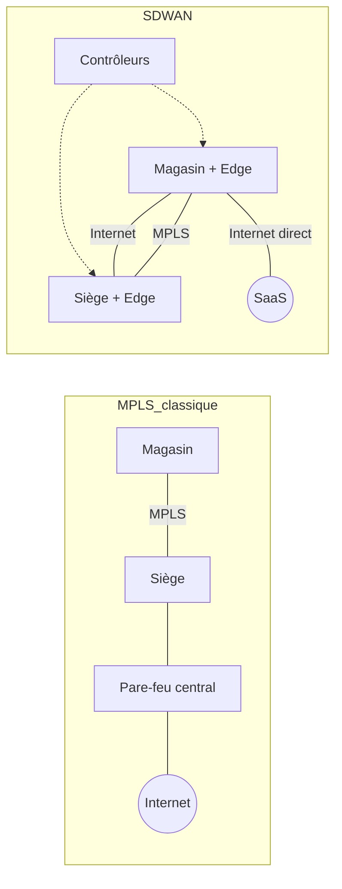

# SW01. Du WAN traditionnel au SD-WAN

| | |
|---|---|
| **Partie** | A. Fondamentaux du SD-WAN |
| **Durée indicative** | 1 semaine (6 à 8 h : cours, schémas, lab) |
| **Prérequis** | CCNA 1 à 3 (adressage, routage, notions de WAN et de VPN) |
| **Niveau** | Débutant à intermédiaire |
| **Lien examen** | ENCOR 350-401 (vue d'ensemble SD-WAN), ENSDWI 300-415 (contexte) |
| **Lab associé** | Schémas comparatifs MPLS et SD-WAN (section 11) |

> Module suivant : [SW02. Transports, overlay et underlay](../SW02-transports-overlay-underlay/SW02-transports-overlay-underlay.md)

---

## Table des matières

1. [Objectifs pédagogiques](#1-objectifs-pédagogiques)
2. [Rappels : le WAN d'entreprise](#2-rappels--le-wan-dentreprise)
3. [MPLS L3VPN en 10 minutes](#3-mpls-l3vpn-en-10-minutes)
4. [Les limites du WAN traditionnel](#4-les-limites-du-wan-traditionnel)
5. [Les moteurs du SD-WAN](#5-les-moteurs-du-sd-wan)
6. [Définition du SD-WAN](#6-définition-du-sd-wan)
7. [Architecture générique : les quatre plans](#7-architecture-générique--les-quatre-plans)
8. [Overlay et underlay : le trajet d'un paquet](#8-overlay-et-underlay--le-trajet-dun-paquet)
9. [SD-WAN, VPN, DMVPN et PfR : les précurseurs](#9-sd-wan-vpn-dmvpn-et-pfr--les-précurseurs)
10. [Bénéfices, limites et idées reçues](#10-bénéfices-limites-et-idées-reçues)
11. [Lab : schémas comparatifs MPLS et SD-WAN](#11-lab--schémas-comparatifs-mpls-et-sd-wan)
12. [Exercices](#12-exercices)
13. [Quiz](#13-quiz)
14. [Aide-mémoire](#14-aide-mémoire)
15. [Pour aller plus loin](#15-pour-aller-plus-loin)

---

## 1. Objectifs pédagogiques

À la fin de ce module, vous saurez :

- décrire l'architecture d'un WAN traditionnel (lignes dédiées, MPLS, concentrateur et rayons) ;
- expliquer, chiffres à l'appui, pourquoi ce modèle devient inadapté (cloud, SaaS, sites nombreux) ;
- définir le SD-WAN et citer ses quatre caractéristiques canoniques ;
- nommer et décrire les quatre plans (orchestration, gestion, contrôle, données) ;
- distinguer **overlay** et **underlay** en suivant le trajet d'un paquet ;
- situer le SD-WAN par rapport à MPLS, aux VPN IPsec, à DMVPN et à PfR ;
- dresser un bilan honnête des gains et des risques d'un projet SD-WAN.

---

## 2. Rappels : le WAN d'entreprise

Un **WAN** (Wide Area Network) relie des sites géographiquement distants : siège, agences, usines, magasins, centres de données, clouds.

### 2.1 Topologies classiques

```text
Point à point            Concentrateur et rayons (hub and spoke)      Maillage complet (full mesh)

 A ------- B                    B     C     D                          A ----- B
                                 \    |    /                           | \   / |
                                  \   |   /                            |  \ /  |
                                   [ SIEGE ]                           |  / \  |
                                      |                                | /   \ |
                                  Internet                             D ----- C
```

| Topologie | Avantages | Inconvénients | Usage typique |
|---|---|---|---|
| Point à point | Simple, performances prévisibles | Ne passe pas à l'échelle (N sites → N(N-1)/2 liens) | 2 sites critiques |
| Concentrateur et rayons | Peu de liens, contrôle central, sortie Internet unique | Le concentrateur est un goulot ; trafic inter-sites en « épingle à cheveux » | Réseaux d'agences |
| Maillage complet | Latence minimale entre sites | Coût et complexité élevés | Quelques sites très liés |
| Maillage partiel | Compromis | Conception délicate | Régions |

### 2.2 Technologies de transport historiques

| Technologie | Description | Remarque |
|---|---|---|
| Ligne louée (E1/T1, SDH) | Circuit dédié point à point | Très fiable, très cher |
| Frame Relay, ATM | Commutation de paquets ou de cellules | Disparus ou en voie de disparition |
| **MPLS L3VPN** | Service IP privé géré par l'opérateur (RFC 4364) | Longtemps la référence pour les entreprises |
| Metro Ethernet / VPLS / E-LAN | Service Ethernet (couche 2) | Souvent en zone métropolitaine |
| VPN IPsec sur Internet | Tunnels chiffrés sur accès Internet | Bon marché, sans garantie de service |

### 2.3 Le trafic Internet « en épingle à cheveux »

Dans le modèle historique, **tout le trafic Internet des agences est ramené au siège** (pour y être filtré par un pare-feu et un proxy central), puis ressort vers Internet.

```text
Agence de Lyon                                   Siège (Paris)                    Internet / SaaS
+----------+      MPLS (2 x 20 ms)             +-----------------+              +--------------+
| Utilisat.|===================================|  Pare-feu       |==============| Microsoft 365|
+----------+   trafic SaaS "ramené" au siège   |  Proxy          |   10 ms      +--------------+
                                               +-----------------+
```

**Exemple chiffré (illustratif)** : l'utilisateur de Lyon veut joindre Microsoft 365.

| Chemin | Délai aller (ms) | Aller-retour (ms) |
|---|---|---|
| Via le siège : Lyon → Paris (MPLS) 12 + traitement siège 2 + Paris → point de présence Microsoft 8 | 22 | 44 |
| Accès direct à Internet depuis Lyon (point de présence proche) | 8 | 16 |

Une application « bavarde » (par exemple 40 échanges aller-retour pour charger une page) passe de 40 × 44 = 1 760 ms à 40 × 16 = 640 ms de latence cumulée, soit **près de trois fois moins**. C'est l'un des arguments majeurs du SD-WAN : l'**accès direct à Internet** (DIA, local breakout) sécurisé.

---

## 3. MPLS L3VPN en 10 minutes

Pour comprendre ce que le SD-WAN remplace ou complète, il faut maîtriser le service MPLS L3VPN.

### 3.1 Vocabulaire

| Terme | Rôle |
|---|---|
| **CE** (Customer Edge) | Routeur du client, en bordure de site |
| **PE** (Provider Edge) | Routeur de l'opérateur auquel le CE se connecte ; porte une **VRF** par client |
| **P** (Provider) | Routeur de cœur de l'opérateur, commute les étiquettes |
| **VRF** | Table de routage virtuelle (une par client sur le PE) |
| **RD** (Route Distinguisher) | Rend les préfixes uniques entre clients (ex. 65000:10) |
| **RT** (Route Target) | Étiquette BGP qui contrôle l'import et l'export des routes entre VRF |
| **Étiquettes MPLS** | Deux étiquettes : une pour atteindre le PE de sortie (transport), une pour la VRF (service) |

### 3.2 Fonctionnement résumé

```text
 Site A                      Réseau de l'opérateur                       Site B
+------+   eBGP/OSPF   +------+   iBGP VPNv4 (MP-BGP)   +------+   eBGP/OSPF   +------+
|  CE  |--------------|  PE1 |-------------------------|  PE2 |--------------|  CE  |
+------+              +--+---+      cœur MPLS (P)        +--+---+              +------+
                         |          [ LDP / SR ]            |
                         +----------[ P ]----[ P ]----------+
Paquet IP client -> PE1 ajoute [étiquette transport | étiquette VRF] -> P commute -> PE2 retire -> CE
```

Points essentiels :

1. Le CE échange ses routes avec le PE (BGP, OSPF ou statique).
2. Les PE échangent les routes clients entre eux par **MP-BGP** (famille VPNv4).
3. Le trafic est commuté par étiquettes dans le cœur : le client ne voit **jamais** les routeurs P.
4. L'isolation entre clients est assurée par les VRF. **Le trafic n'est pas chiffré** : la confidentialité repose sur la confiance dans l'opérateur.

### 3.3 Exemple : configuration d'un CE (Cisco IOS XE) vers un PE en BGP

```text
! CE du site de Lyon : AS privé 65101, PE de l'opérateur en AS 64512
interface GigabitEthernet0/0/0
 description LIEN-MPLS-VERS-PE
 ip address 192.0.2.2 255.255.255.252
 no shutdown
!
router bgp 65101
 bgp log-neighbor-changes
 neighbor 192.0.2.1 remote-as 64512
 neighbor 192.0.2.1 description PE-OPERATEUR
 !
 address-family ipv4
  network 10.20.0.0 mask 255.255.0.0
  neighbor 192.0.2.1 activate
  neighbor 192.0.2.1 prefix-list OUT-LYON out
  neighbor 192.0.2.1 prefix-list IN-DEFAUT-SIEGE in
 exit-address-family
!
ip prefix-list OUT-LYON seq 10 permit 10.20.0.0/16
ip prefix-list IN-DEFAUT-SIEGE seq 10 permit 10.0.0.0/8 le 24
ip prefix-list IN-DEFAUT-SIEGE seq 20 permit 0.0.0.0/0
```

Vérifications usuelles :

```text
show ip bgp summary
show ip route bgp
show ip bgp neighbors 192.0.2.1 advertised-routes
```

> Point d'attention : filtrer systématiquement ce que l'on annonce à l'opérateur et ce que l'on accepte de lui. Cette discipline sera indispensable pour la coexistence MPLS et SD-WAN (module SW14).

---

## 4. Les limites du WAN traditionnel

### 4.1 Coût de la bande passante

La capacité MPLS est facturée plusieurs fois le prix d'un accès Internet professionnel équivalent. Les ordres de grandeur ci-dessous sont **illustratifs** (ils varient fortement selon le pays, l'opérateur et le débit).

| Type d'accès | Débit | Coût mensuel indicatif | Coût par Mbit/s |
|---|---|---|---|
| MPLS | 20 Mbit/s | 600 € | 30 € |
| Accès Internet professionnel (DIA) | 200 Mbit/s | 250 € | 1,25 € |
| Fibre grand public pro | 500 Mbit/s | 60 € | 0,12 € |

### 4.2 Autres limites

| Limite | Explication |
|---|---|
| **Délai de déploiement** | Une commande MPLS prend souvent de 30 à 90 jours (génie civil, contrats). |
| **Rigidité** | Changer de débit ou d'opérateur est lent et contractuel. |
| **Expérience SaaS dégradée** | Le trafic cloud fait un détour par le siège. |
| **Administration** | Configuration équipement par équipement, scripts maison, erreurs de copier-coller. |
| **Visibilité limitée** | Pas de vue applicative de bout en bout ; l'opérateur ne voit que son segment. |
| **Résilience** | Un seul opérateur MPLS est un point de défaillance ; le secours par VPN IPsec est souvent manuel ou lent. |
| **Sécurité** | Pas de chiffrement natif ; pare-feu centralisé au siège, saturé par le trafic Internet des agences. |

### 4.3 Exemple de calcul de TCO (coût total de possession) sur 3 ans

Entreprise fictive de 30 agences, chacune avec un lien MPLS 20 Mbit/s.

**Situation actuelle (MPLS seul)**

| Poste | Calcul | Total 3 ans |
|---|---|---|
| Liens MPLS | 30 × 600 € × 36 mois | 648 000 € |
| Routeurs (amortissement + support) | 30 × 3 000 € | 90 000 € |
| Exploitation (0,5 ETP) | 0,5 × 60 000 € × 3 | 90 000 € |
| **Total** | | **828 000 €** |

**Cible (SD-WAN avec DIA 200 Mbit/s + 4G de secours, MPLS conservé sur 6 sites critiques)**

| Poste | Calcul | Total 3 ans |
|---|---|---|
| Liens DIA | 30 × 250 € × 36 | 270 000 € |
| Liens 4G/5G de secours | 30 × 40 € × 36 | 43 200 € |
| MPLS conservé (6 sites) | 6 × 600 € × 36 | 129 600 € |
| Équipements SD-WAN (matériel + licences 3 ans) | 30 × 5 500 € | 165 000 € |
| Exploitation (0,3 ETP) | 0,3 × 60 000 € × 3 | 54 000 € |
| Projet de migration (une fois) | forfait | 60 000 € |
| **Total** | | **721 800 €** |

Économie : 828 000 − 721 800 = **106 200 €** (environ 13 %), avec **dix fois plus de bande passante** par site. Le gain est moins spectaculaire que le discours commercial : le calcul doit être mené honnêtement, **licences et migration incluses**.

---

## 5. Les moteurs du SD-WAN

| Moteur | Conséquence |
|---|---|
| **Applications dans le cloud** (SaaS, IaaS) | Le trafic ne va plus vers le centre de données mais vers Internet |
| **Sites nombreux et distants** | Besoin de déploiement sans intervention locale |
| **Accès Internet bon marché et rapide** | Opportunité d'utiliser plusieurs transports en parallèle |
| **Mobilité et sites éphémères** | 4G et 5G comme transport principal ou de secours |
| **Sécurité** | Besoin de chiffrer et de segmenter de bout en bout, de filtrer localement |
| **Agilité** | Les changements de politique doivent se faire en minutes, pas en semaines |

---

## 6. Définition du SD-WAN

Le **SD-WAN** (Software-Defined Wide Area Network) applique à la couche WAN les principes du **SDN** (Software-Defined Networking) : séparer la logique de contrôle de l'acheminement des paquets et la piloter depuis un point central.

Le cabinet Gartner a popularisé quatre caractéristiques qui définissent une solution SD-WAN :

1. **Prise en charge de plusieurs types de connexion** (MPLS, Internet, 4G et 5G, satellite…).
2. **Sélection dynamique de chemin** pour répartir le trafic selon des politiques et la qualité mesurée.
3. **Interface de gestion simple** : configuration et politiques centralisées, déploiement sans intervention.
4. **Prise en charge des VPN et de services tiers** : chiffrement, pare-feu, optimisation, passerelles de sécurité.

> **Ce que le SD-WAN n'est pas** : ce n'est ni un remplaçant de MPLS en tant que technologie (MPLS peut rester un transport parmi d'autres), ni un VPN IPsec classique. C'est une **couche de pilotage et d'abstraction** posée sur n'importe quel transport.

---

## 7. Architecture générique : les quatre plans

```text
+--------------------------------------------------------------------------------+
|  PLAN D'ORCHESTRATION  : admission et authentification des équipements         |
|  PLAN DE GESTION       : configuration, supervision, politiques, analytique    |
|  PLAN DE CONTROLE      : distribution des routes, des clés et des politiques   |
+---------------------------------------+----------------------------------------+
                                        |  connexions de contrôle (TLS/DTLS)
        +-------------------------------+-------------------------------+
        |                               |                               |
   +----+-----+                    +----+-----+                    +----+-----+
   | Équipement|====== PLAN DE =====| Équipement|====== DONNEES ====| Équipement|
   |  (Site A) |   tunnels chiffrés |  (Site B) |                   |  (Site C) |
   +-----------+                    +-----------+                   +-----------+
        |                                |                               |
   Transport 1 : MPLS     Transport 2 : Internet     Transport 3 : 4G / 5G  (UNDERLAY)
```

| Plan | Fonction | Exemple Cisco | Équivalent chez d'autres éditeurs |
|---|---|---|---|
| **Orchestration** | Un équipement qui démarre trouve les contrôleurs et est authentifié | SD-WAN Validator (ex-vBond) | Orchestrateur (Aruba EdgeConnect), service de provisionnement du cloud (Meraki) |
| **Gestion** | Configuration, supervision, politiques, alarmes, API | SD-WAN Manager (ex-vManage) | Dashboard Meraki, FortiManager, Prisma SD-WAN, VeloCloud Orchestrator |
| **Contrôle** | Annonce des routes, des points de terminaison de tunnel, des clés, distribution des politiques | SD-WAN Controller (ex-vSmart), protocole OMP | Passerelles, contrôleur, ADVPN (Fortinet) |
| **Données** | Transfert des paquets des utilisateurs dans les tunnels | WAN Edge (Catalyst 8000) | FortiGate, ION, Edge VeloCloud, EdgeConnect |

Idée clé : **le plan de contrôle est centralisé** (ou logiquement centralisé), **le plan de données est distribué**. Si les contrôleurs tombent, les tunnels existants continuent à transférer le trafic pendant un temps limité (comportement dit de « graceful restart », variable selon les éditeurs).

---

## 8. Overlay et underlay : le trajet d'un paquet

- **Underlay** : le réseau de transport physique et ses opérateurs (MPLS, Internet, 4G…). Il ne connaît que des adresses « publiques » ou de transport.
- **Overlay** : le réseau logique de tunnels construit **par-dessus** l'underlay. Il transporte les adresses privées de l'entreprise.

**Suivi d'un paquet** du PC 10.1.1.10 (site A) vers le serveur 10.2.2.20 (site B) :

```text
1. Le PC envoie :            [ IP 10.1.1.10 -> 10.2.2.20 | données ]
2. L'équipement A consulte sa table de routage (overlay) : "10.2.2.0/24 via site B, tunnel couleur biz-internet"
3. Il chiffre et encapsule :
   [ IP 198.51.100.2 -> 203.0.113.9 | UDP | ESP | (chiffré : IP 10.1.1.10 -> 10.2.2.20 | données) ]
    ^-- en-tête de l'underlay (adresses publiques)   ^-- paquet d'origine protégé
4. Les routeurs d'Internet (underlay) ne voient que 198.51.100.2 -> 203.0.113.9
5. L'équipement B déchiffre et remet le paquet d'origine au LAN du site B
```

Conséquences pratiques :

| Constat | Explication |
|---|---|
| L'overlay fonctionne sur **n'importe quel** transport | Les adresses de l'underlay n'ont aucun lien avec le plan d'adressage interne |
| Le paquet est **plus gros** après encapsulation | Il faut gérer la **MTU** et le **MSS** (module SW02) |
| Le chiffrement protège contre l'opérateur | Utile surtout sur Internet |
| Chaque couche a **son propre routage** | Il faut distinguer routage de l'underlay (accès) et routage de l'overlay (entreprise) |

> Piège classique : confondre **couleur** (étiquette d'un transport dans Cisco SD-WAN) et **VPN** (segment de l'overlay). Le premier décrit un chemin physique, le second un domaine de routage. Voir SW04.

---

## 9. SD-WAN, VPN, DMVPN et PfR : les précurseurs

| Technologie | Idée | Ce qui manque par rapport au SD-WAN |
|---|---|---|
| **VPN IPsec site à site** | Tunnels chiffrés statiques | Configuration manuelle, pas de choix de chemin dynamique, N² tunnels en maillage |
| **DMVPN** (mGRE + NHRP + IPsec) | Maillage dynamique rayon à rayon à la demande | Pas d'orchestration centralisée, supervision limitée, politiques par équipement |
| **PfR** (Performance Routing) | Choix de chemin selon la performance mesurée | Fonction de routeur, administration complexe, pas de modèle unifié |
| **MPLS TE / DiffServ** | Ingénierie de trafic dans le réseau de l'opérateur | Limité au réseau de l'opérateur |
| **SD-WAN** | Overlay chiffré + choix de chemin par application + gestion centrale + ZTP | Introduit un nouveau système à exploiter et un éditeur de référence |

Le SD-WAN intègre dans un produit cohérent des idées déjà présentes dans DMVPN (maillage dynamique) et PfR (mesure de qualité), avec **une couche d'orchestration et de gestion centralisée**.

### Les trois modèles de déploiement

| Modèle | Description | Exemples |
|---|---|---|
| **Basé sur l'équipement (CPE)** | Équipements de site et contrôleurs gérés par le client ou l'éditeur | Cisco Catalyst SD-WAN, Fortinet, Palo Alto |
| **Basé sur des passerelles cloud** | Les sites se connectent à des passerelles dans le cloud de l'éditeur | VeloCloud, Cato Networks |
| **Service géré** | Un opérateur ou intégrateur exploite la solution | Offres opérateur, Aryaka |

---

## 10. Bénéfices, limites et idées reçues

| Bénéfice | Précision |
|---|---|
| Réduction des coûts | Réelle mais souvent modérée une fois licences et migration comptées |
| Performance applicative | Réelle : choix de chemin, accès direct au SaaS |
| Déploiement rapide | Réel avec ZTP, mais le **lien Internet** reste à livrer par l'opérateur |
| Agilité des politiques | Réelle, à condition d'avoir une gouvernance des changements |
| Visibilité | Réelle, sur les applications et chemins |

| Limite ou risque | Précision |
|---|---|
| Complexité de transition | Coexistence avec l'ancien WAN à planifier |
| Dépendance à un éditeur | Peu d'interopérabilité entre solutions |
| Qualité variable des accès Internet | Le SD-WAN **atténue** la variabilité, ne l'élimine pas |
| Nouvelles compétences | Overlay, certificats, politiques, API |
| Nouveau point critique | Les contrôleurs et la chaîne de certificats |

**Idées reçues**

| Idée reçue | Réalité |
|---|---|
| « Le SD-WAN remplace MPLS. » | Il peut le remplacer, le compléter ou le garder comme un transport de qualité parmi d'autres. |
| « Le SD-WAN supprime le routage. » | Non : l'overlay s'interconnecte avec OSPF, BGP, etc. côté LAN, centre de données et opérateurs. |
| « Internet est aussi fiable que MPLS grâce au SD-WAN. » | Le SD-WAN contourne les dégradations mais ne crée pas de garanties contractuelles (SLA). |
| « Le SD-WAN, c'est la sécurité. » | Il fournit chiffrement et segmentation ; la sécurité applicative et web demande des fonctions complémentaires (SW08, SW12). |
| « C'est du cloud donc rien à exploiter. » | Les contrôleurs hébergés restent à superviser, mettre à jour, sécuriser (comptes, certificats). |

---

## 11. Lab : schémas comparatifs MPLS et SD-WAN

### 11.1 Énoncé

**Cahier des charges** : une chaîne de 12 magasins et un siège. Chaque magasin accède à : (1) un ERP hébergé au siège, (2) Microsoft 365, (3) la vidéosurveillance (flux montants vers le siège), (4) un terminal de paiement (flux isolé).

Produisez :

1. un schéma de l'architecture **MPLS classique** (liens, sortie Internet centralisée, pare-feu) ;
2. un schéma de l'architecture **SD-WAN** (deux transports par magasin, contrôleurs, sortie Internet locale) ;
3. un tableau **avant / après** (coût, délai de déploiement d'un nouveau magasin, expérience Microsoft 365, résilience, sécurité, exploitation) ;
4. une **liste de risques** de la migration (au moins 5) avec parade.

### 11.2 Outils conseillés

- draw.io (diagrams.net) ou Excalidraw ;
- ou **Mermaid** (rendu directement par GitHub) :

````text

````

### 11.3 Corrigé (extrait)

| Critère | MPLS classique | SD-WAN |
|---|---|---|
| Coût liens (12 magasins) | 12 × 500 €/mois = 6 000 € | 12 × (200 € DIA + 50 € 4G) = 3 000 € + MPLS conservé sur 2 sites |
| Délai d'ouverture d'un magasin | 45 à 90 jours (MPLS) | 15 à 30 jours (accès Internet) + ZTP |
| Microsoft 365 | Via le siège (+ 20 à 30 ms) | Accès direct, choix du meilleur chemin |
| Résilience | Un lien ; secours VPN lent | Deux transports, bascule en quelques secondes |
| Sécurité | Pare-feu central | Segmentation + pare-feu local + filtrage cloud |
| Exploitation | Configuration individuelle | Modèles centralisés |

Exemples de risques : (1) qualité insuffisante de l'accès Internet d'un magasin, parade : 4G de secours et SLA ; (2) boucle de routage pendant la coexistence MPLS et SD-WAN, parade : balises de routes ; (3) panne des contrôleurs, parade : haute disponibilité ; (4) conformité paiement, parade : segment dédié ; (5) compétences, parade : formation et documentation.

---

## 12. Exercices

1. **Calcul de liens.** Combien de liens faut-il pour un maillage complet de 15 sites ? Pour un concentrateur et rayons ? 
2. **Latence.** Un site subit 35 ms de MPLS vers le siège et le siège est à 12 ms de l'application SaaS. Calculez l'aller-retour via le siège et via un accès direct à 10 ms. Quelle est l'économie sur une page de 30 échanges ?
3. **Vocabulaire.** Classez : « NHRP », « OMP », « VRF », « TLOC », « ESP », « PE » : relèvent-ils de l'overlay, de l'underlay, ou des deux ?
4. **Analyse critique.** Un commercial affirme : « Avec le SD-WAN, vous n'aurez plus jamais de problème de qualité sur Internet. » Rédigez une réponse argumentée en cinq lignes.
5. **Plans.** Pour chaque tâche, indiquez le plan concerné (orchestration, gestion, contrôle, données) : (a) pousser une politique QoS sur 200 sites ; (b) chiffrer un paquet ; (c) vérifier qu'un équipement neuf est autorisé ; (d) annoncer les routes d'un site aux autres.

<details>
<summary>Corrigés</summary>

1. Maillage complet : 15 × 14 / 2 = **105** liens. Concentrateur et rayons : **14** liens.
2. Via le siège : 2 × (35 + 12) = **94 ms**. Accès direct : 2 × 10 = **20 ms**. Sur 30 échanges : 30 × 94 = 2 820 ms contre 30 × 20 = 600 ms, soit **2 220 ms** d'économie.
3. NHRP : overlay (DMVPN). OMP : overlay (plan de contrôle SD-WAN). VRF : les deux (segmente l'overlay, existe aussi dans MPLS). TLOC : overlay (point de terminaison de transport, lien avec l'underlay). ESP : overlay (chiffrement des tunnels, encapsulé dans l'underlay). PE : underlay (réseau de l'opérateur).
4. Le SD-WAN détecte et contourne les dégradations en choisissant un autre chemin, il peut corriger certaines pertes (FEC, duplication), mais il ne crée pas de garantie contractuelle ; si **tous** les transports se dégradent, l'application souffre aussi. Il réduit le risque, sans l'éliminer.
5. (a) Gestion, (b) données, (c) orchestration, (d) contrôle.

</details>

---

## 13. Quiz

1. Quelle est la principale différence entre overlay et underlay ?
   a) L'overlay est physique, l'underlay logique ; b) L'overlay est logique et chiffré, l'underlay est le transport ; c) Aucune ; d) L'underlay n'existe qu'en 4G.
2. Quel plan distribue les routes et les politiques aux équipements ?
   a) Orchestration ; b) Gestion ; c) Contrôle ; d) Données.
3. MPLS L3VPN chiffre nativement le trafic des clients.
   a) Vrai ; b) Faux.
4. Citez trois limites d'un WAN traditionnel.
5. Pourquoi le trafic SaaS est-il dégradé dans un modèle « tout via le siège » ?
6. Quel mécanisme des routeurs précède historiquement la mesure de qualité de chemin du SD-WAN ?
   a) PfR ; b) STP ; c) VTP ; d) CDP.
7. Un SD-WAN peut conserver MPLS comme transport.
   a) Vrai ; b) Faux.
8. Quelle est la différence entre SD-WAN et SASE (en une phrase) ?

<details>
<summary>Réponses</summary>

1. b. 2. c. 3. b (Faux : l'isolation repose sur les VRF, pas sur le chiffrement). 4. Coût MPLS, délais de déploiement, rigidité, visibilité limitée, expérience SaaS dégradée, administration équipement par équipement. 5. Détour géographique, pare-feu central saturé, double traversée du WAN. 6. a. 7. a. 8. Le SD-WAN pilote le réseau étendu et le choix de chemin ; le SASE y ajoute les services de sécurité fournis dans le cloud (SWG, CASB, ZTNA, FWaaS).

</details>

---

## 14. Aide-mémoire

- **Quatre plans** : orchestration → gestion → contrôle → données.
- **Overlay** = tunnels logiques ; **underlay** = transports.
- **Quatre critères Gartner** : multi-transports, chemin dynamique, gestion simple, VPN et services tiers.
- **Avantages** : coût, performance, agilité, visibilité ; **risques** : transition, dépendance, qualité des accès.
- **Formules** : maillage complet = N(N−1)/2 ; concentrateur et rayons = N−1 liens.
- **DIA** : accès direct à Internet depuis le site ; sécurité à prévoir localement ou dans le cloud.

## 15. Pour aller plus loin

- RFC 4364 (BGP/MPLS IP VPN) : <https://www.rfc-editor.org/rfc/rfc4364>
- Cisco, guides de conception SD-WAN : <https://www.cisco.com/c/en/us/solutions/enterprise-networks/sd-wan/index.html>
- Lecture complémentaire : MEF 70 (définition normalisée du SD-WAN) : <https://www.mef.net>

---

## Approfondissements

### A. Glossaire du module

| Terme | Définition |
|---|---|
| **WAN** | Réseau étendu reliant des sites distants à travers des infrastructures d'opérateurs |
| **LAN** | Réseau local d'un site (commutateurs, Wi-Fi) |
| **CPE / CE** | Équipement installé chez le client (Customer Premises Equipment, Customer Edge) |
| **PE / P** | Routeurs de bordure et de cœur de l'opérateur |
| **MPLS** | Commutation par étiquettes dans le réseau d'un opérateur ; base des VPN L3 (RFC 4364) |
| **VRF** | Instance de routage virtuelle (une table de routage par client ou par segment) |
| **GTR** | Garantie de temps de rétablissement : délai contractuel de remise en service après panne |
| **SLA / SLO / SLI** | Engagement de niveau de service / objectif visé / indicateur mesuré |
| **DIA** | Accès Internet dédié, avec débit et support contractuels |
| **Local breakout** | Sortie Internet locale depuis le site, sans passer par le siège |
| **Backhauling** | Ramener tout le trafic vers un point central avant de l'envoyer ailleurs |
| **Overlay / underlay** | Réseau logique de tunnels / réseau de transport sous-jacent |
| **SDN** | Séparation de la logique de contrôle et du transfert, pilotée par logiciel |
| **ZTP** | Mise en service sans intervention locale |
| **TCO** | Coût total de possession (achat, licences, exploitation, migration) |
| **Hairpinning** | Trafic qui entre et ressort par le même point, en « épingle » |
| **Churn d'opérateur** | Changement d'opérateur ; difficile avec MPLS car les adresses et la topologie sont liées à l'opérateur |

### B. Cas d'usage détaillés

Les cas ci-dessous sont des **scénarios réalistes mais fictifs**, construits à partir de situations typiques rencontrées dans les projets WAN. Chiffres illustratifs.

#### Cas 1. Chaîne de 120 magasins de prêt-à-porter

| Rubrique | Détail |
|---|---|
| **Contexte** | 120 magasins, 1 siège, 1 centre de données. Caisses, vidéosurveillance, Wi-Fi clients, messagerie |
| **Situation initiale** | MPLS 4 Mbit/s par magasin, ADSL de secours non surveillé, pare-feu central |
| **Douleurs** | Caisses lentes aux soldes, Wi-Fi clients saturant le lien, 6 semaines pour ouvrir un magasin |
| **Solution SD-WAN** | Fibre grand public pro + 4G en secours, segments « caisses / vidéo / invités », invités en sortie Internet locale |
| **Gains** | Ouverture d'un magasin en 10 jours, bande passante × 25, 18 % d'économie sur 3 ans, disparition des appels « la caisse est lente » |
| **Leçons** | La **segmentation PCI** (caisses) a été le vrai moteur de la décision ; le gain de coût n'était qu'un bonus |

#### Cas 2. Réseau de 40 cabinets de radiologie

| Rubrique | Détail |
|---|---|
| **Contexte** | Images médicales volumineuses (centaines de Mo) vers un serveur central, données de santé |
| **Contrainte** | Confidentialité (hébergement de données de santé), disponibilité en heures d'ouverture |
| **Solution** | Deux accès par cabinet, tunnels chiffrés, QoS réservant du débit aux transferts d'images en journée, sauvegardes en heures creuses |
| **Résultat** | Temps de transmission d'un examen divisé par 4, double accès éprouvé lors d'un incident de fibre |
| **Leçons** | Le **lissage** (shaping) a plus apporté que l'augmentation du débit |

#### Cas 3. Industriel avec 8 usines et sites OT

| Rubrique | Détail |
|---|---|
| **Contexte** | Usines avec automates, supervision industrielle (SCADA), ERP au siège |
| **Contrainte** | Les flux OT ne doivent jamais être joignables depuis Internet, arrêt de production très coûteux |
| **Solution** | Segment OT dédié et isolé, passerelles contrôlées avec l'IT, liens redondants avec opérateurs distincts, 5G de secours |
| **Leçons** | Faire valider l'architecture par l'équipe de production ; aucun changement de politique sans fenêtre de maintenance |

#### Cas 4. Banque régionale (60 agences)

| Rubrique | Détail |
|---|---|
| **Contexte** | Exigences réglementaires fortes, audits réguliers |
| **Solution** | Conservation de MPLS sur les sites principaux, SD-WAN sur Internet pour les agences, chiffrement systématique, journalisation vers un SIEM |
| **Leçons** | Le SD-WAN **ne remplace pas la gouvernance** : le dossier d'audit (preuves de segmentation, traçabilité des changements) a pris autant de temps que le déploiement |

#### Cas 5. Entreprise de services avec 400 télétravailleurs et 12 bureaux

| Rubrique | Détail |
|---|---|
| **Problème** | Les télétravailleurs passaient par un VPN ramenant tout le trafic au siège ; Microsoft Teams hachait |
| **Solution** | Bureaux en SD-WAN avec sortie locale ; télétravailleurs en accès par application (ZTNA, voir SW12) |
| **Leçons** | Le SD-WAN règle le problème **des sites**, pas celui des **utilisateurs mobiles** : d'où l'arrivée du SASE |

### C. Retours d'expérience : ce que l'on constate sur le terrain

1. **Sous-estimer le délai opérateur.** Le matériel arrive en 3 semaines ; la fibre, en 3 mois. Le planning du projet est dominé par les **délais de livraison des accès**.
2. **Migrer sans inventaire.** Dans presque chaque projet, on découvre des liens, des routes statiques ou des équipements oubliés (alarme incendie, monétique, ascenseur) qui dépendent de l'ancien WAN.
3. **Confondre bande passante et qualité.** Un lien à 1 Gbit/s qui perd 1 % de paquets est pire qu'un lien à 50 Mbit/s propre (voir la formule de Mathis, SW02).
4. **Oublier les flux « silencieux ».** Les applications métier anciennes utilisent des ports et des adresses codés en dur ; elles se révèlent le jour de la bascule.
5. **Négliger la formation.** Un réseau pilotable par politiques donne un pouvoir considérable : une erreur de politique peut couper cent sites en une minute. La **discipline de changement** compte autant que la technique.
6. **Croire le discours commercial sur les gains de coût.** Faites le calcul de TCO vous-même, licences et migration comprises.
7. **Ne pas prévoir la sortie.** Choisir un éditeur, c'est s'engager sur plusieurs années : documentez les **fonctions utilisées** et les **dépendances** pour garder une capacité de changer.

### D. Questions de réflexion et d'entretien

1. Expliquez à un directeur financier pourquoi un lien Internet à 250 € par mois n'équivaut pas à un MPLS à 600 € par mois, et dans quels cas le MPLS reste justifié.
2. Un client demande « du SD-WAN pour réduire la facture ». Quelles questions lui posez-vous avant de répondre ?
3. Citez trois situations où le SD-WAN **n'est pas** la bonne réponse (par exemple : 3 sites, tous sur un seul opérateur de qualité, aucune application cloud).
4. Quelle est la différence entre « une architecture SD-WAN » et « un produit SD-WAN » ?

### E. Mini-projet (3 à 4 heures)

Choisissez l'un des cinq cas ci-dessus et produisez un **dossier d'une page** : problème, contraintes, choix de transports, politique de sortie Internet, plan de segmentation, trois risques et leurs parades. Présentez-le oralement en 5 minutes à un public non technique.

---

> Module suivant : [SW02. Transports, overlay et underlay](../SW02-transports-overlay-underlay/SW02-transports-overlay-underlay.md)
