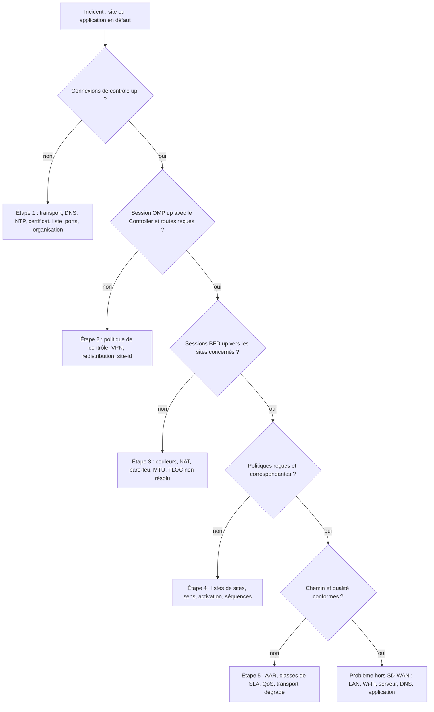

# SW10. Supervision, exploitation et dépannage

| | |
|---|---|
| **Partie** | B. Cisco Catalyst SD-WAN |
| **Durée indicative** | 2 semaines (16 h) |
| **Prérequis** | SW04 à SW09 |
| **Niveau** | Avancé |
| **Lien examen** | ENSDWI 300-415 : « Gestion et exploitation » ; compétence la plus valorisée sur le terrain |
| **Lab associé** | T8 (série de pannes injectées, diagnostic chronométré, fiche d'incident) |

> Module précédent : [SW09](../SW09-cloud-onramp/SW09-cloud-onramp.md) | Module suivant : [SW11](../../03-partie-c-solutions-et-sase/SW11-panorama-solutions/SW11-panorama-solutions.md)

> **Avertissement.** Les noms de menus du Manager, les commandes et les codes d'erreur évoluent selon la version. Vérifiez dans la documentation de la version déployée. Les exercices d'injection de pannes se font **uniquement en laboratoire**.

---

## Table des matières

1. [Objectifs pédagogiques](#1-objectifs-pédagogiques)
2. [Supervision dans le SD-WAN Manager](#2-supervision-dans-le-sd-wan-manager)
3. [Alarmes, événements et notifications](#3-alarmes-événements-et-notifications)
4. [Outils de diagnostic intégrés](#4-outils-de-diagnostic-intégrés)
5. [Analytique et outils complémentaires](#5-analytique-et-outils-complémentaires)
6. [Exploitation au quotidien](#6-exploitation-au-quotidien)
7. [La méthode de dépannage par plan](#7-la-méthode-de-dépannage-par-plan)
8. [Catalogue de pannes avec diagnostic pas à pas](#8-catalogue-de-pannes-avec-diagnostic-pas-à-pas)
9. [Commandes de diagnostic de l'IOS XE SD-WAN](#9-commandes-de-diagnostic-de-lios-xe-sd-wan)
10. [Capture de paquets et trace de chemin](#10-capture-de-paquets-et-trace-de-chemin)
11. [Automatiser les contrôles de santé](#11-automatiser-les-contrôles-de-santé)
12. [Fiche d'incident et escalade](#12-fiche-dincident-et-escalade)
13. [Lab guidé T8 : pannes injectées](#13-lab-guidé-t8--pannes-injectées)
14. [Approfondissements](#14-approfondissements)
15. [Quiz](#15-quiz)
16. [Aide-mémoire](#16-aide-mémoire)
17. [Pour aller plus loin](#17-pour-aller-plus-loin)

---

## 1. Objectifs pédagogiques

- Utiliser les tableaux de bord, alarmes et événements du Manager pour détecter un problème.
- Appliquer la **méthode par plan** pour localiser une panne en quelques minutes.
- Interpréter les sorties des commandes `show sdwan` essentielles.
- Diagnostiquer les 12 pannes les plus fréquentes.
- Capturer et tracer un flux pour prouver où il passe.
- Automatiser des contrôles de santé et rédiger une fiche d'incident professionnelle.

---

## 2. Supervision dans le SD-WAN Manager

### 2.1 Pages principales

| Page (menu Monitor) | Informations |
|---|---|
| **Overview** | Nombre d'équipements, de contrôleurs, de tunnels, alarmes, états de connexion de contrôle |
| **Devices** | Liste des équipements, état, version, CPU, mémoire, détails par équipement |
| **Tunnels** | Qualité (perte, délai, gigue) de chaque tunnel de données |
| **Applications** | Débit par application, par site |
| **Security** | Statistiques de pare-feu, IPS, filtrage |
| **Logs** | Alarmes, événements, journal d'audit |
| **Network Wide** (selon version) | Vues globales et tendances |

### 2.2 Détail d'un équipement

| Onglet | Utilité |
|---|---|
| **Real Time** | Exécute les commandes `show` choisies, sans se connecter en SSH |
| **Control Connections** | État des connexions vers les contrôleurs |
| **WAN > Tunnel / Application-Aware Routing** | Mesures par tunnel, par classe de SLA |
| **Interface / Hardware Health** | Débit, erreurs, CPU, mémoire, température |
| **Troubleshooting** | Connectivité, ping, trace route, capture de paquets |

### 2.3 États à connaître

| État | Signification |
|---|---|
| **Reachable / Unreachable** | Le Manager joint (ou non) l'équipement |
| **Control connections up / partial / down** | Santé du plan de contrôle |
| **BFD sessions up / down** | Santé du plan de données |
| **Config sync** | Configuration cohérente avec le modèle |

---

## 3. Alarmes, événements et notifications

| Type | Exemple |
|---|---|
| **Alarme** | Perte de connexion de contrôle, tunnel BFD down, certificat proche de l'expiration, CPU élevé |
| **Événement** | Changement d'état d'interface, activation de politique, connexion d'un utilisateur |
| **Audit** | Qui a changé quoi et quand |

### 3.1 Notifications

Dans **Administration > Settings** (alarm notifications) : envoi par **e-mail** ou **webhook** (vers un outil de chat, d'astreinte ou de ticketing). Règle d'or : **peu d'alertes, mais actionnables**.

| Niveau | Cible | Exemple |
|---|---|---|
| **Critique** | Astreinte immédiate | Controller injoignable, certificat contrôleur expire dans 7 jours |
| **Majeur** | Ticket, traitement le jour même | Site isolé (toutes connexions down), tunnel principal down |
| **Mineur** | Revue hebdomadaire | Perte élevée temporaire, CPU > 80 % |
| **Information** | Journal | Connexion d'un utilisateur |

### 3.2 Réduire le bruit

1. Seuils réalistes (une alarme « perte > 0,1 % » sur 4G sera permanente).
2. Corrélation : un site isolé génère 20 alarmes ; n'en traiter qu'une.
3. Fenêtres de maintenance : suspendre les alertes pendant les changements.
4. Revue mensuelle : supprimer ou régler les alertes jamais utiles.

---

## 4. Outils de diagnostic intégrés

| Outil | Où | Usage |
|---|---|---|
| **Ping / Trace Route** depuis l'équipement | Monitor > Devices > Troubleshooting | Tester vers une adresse dans un VPN donné |
| **Simulate Flows** | idem | Prédire le chemin d'un flux selon les politiques |
| **Packet Capture** | idem | Capturer sur une interface (avec filtre) et télécharger le fichier `.pcap` |
| **Operational Commands (Tools)** | Tools > Operational Commands | Exécuter des commandes d'état sur un ou plusieurs équipements |
| **SSH Terminal** | Tools > SSH Terminal | Accès console via le Manager |
| **Admin Tech** | Tools > Admin Tech (ou CLI) | Archive de diagnostic pour le support Cisco |
| **Network-Wide Path Insight** (NWPI) | Monitor / Tools (selon version) | Trace de bout en bout d'un flux à travers l'overlay et l'underlay |

---

## 5. Analytique et outils complémentaires

### 5.1 Network-Wide Path Insight (NWPI)

Principe : **tracer** des flux choisis sur plusieurs équipements et visualiser, par saut, le chemin, les délais, les décisions de politique et les pertes.

| Étape | Action |
|---|---|
| 1 | Créer une trace : sites source et destination, VPN, filtres (IP, port, application) |
| 2 | Démarrer la capture (durée courte, par exemple 5 à 10 minutes) |
| 3 | Examiner : chemin par saut, latence par saut, motif d'un rejet |
| 4 | Conclure : politique, transport ou application en cause |

### 5.2 Supervision de l'expérience applicative

Outils de mesure de l'expérience de bout en bout (par exemple ThousandEyes) : des **agents** (sur des routeurs compatibles ou des machines) testent HTTP, DNS, réseau vers les applications et **visualisent le chemin** dans l'underlay (y compris au-delà de votre réseau). Intérêt : **prouver** qu'un problème vient d'un opérateur ou d'un fournisseur de SaaS.

### 5.3 Analytique de la fabrique

Un service d'analytique (SD-WAN Analytics, selon l'offre) fournit tendances, détection d'anomalies, rapports. Complétez-le par vos propres tableaux de bord (Prometheus/Grafana, voir CP05 et SW18).

---

## 6. Exploitation au quotidien

### 6.1 Calendrier d'exploitation (modèle)

| Fréquence | Tâche |
|---|---|
| **Quotidienne** | Vérifier alarmes critiques et majeures, état des contrôleurs, sauvegarde réussie |
| **Hebdomadaire** | Revue des tunnels instables, des sites à forte perte, des certificats à échéance < 90 jours, des alertes de sécurité éditeur |
| **Mensuelle** | Revue des SLA, de la capacité (liens saturés), des changements, des comptes |
| **Trimestrielle** | Test de restauration, exercice de bascule, revue des politiques, plan de mises à jour |
| **Annuelle** | Revue d'architecture, exercice de reprise après sinistre, audit de sécurité |

### 6.2 Gestion des changements

| Étape | Contenu |
|---|---|
| **Demande** | Motif, périmètre, risque, plan de retour arrière |
| **Évaluation** | Relecture par un pair, impact sur la production |
| **Test** | Sur lab ou site pilote |
| **Fenêtre** | Hors heures de production, communication préalable |
| **Exécution** | Pas à pas, avec vérifications |
| **Validation** | Critères d'acceptation |
| **Clôture** | Documentation, mise à jour des schémas |

### 6.3 Cycle de vie logiciel

| Sujet | Règle |
|---|---|
| **Versions** | Rester sur une version **recommandée** par l'éditeur, en suivant le calendrier de fin de support |
| **Correctifs de sécurité** | Évaluer l'impact sous 7 jours, déployer selon la criticité |
| **Mises à jour** | Voir SW05 (ordre, vagues, retour arrière) |
| **Équipements** | Planifier le remplacement avant la fin de vie |

### 6.4 Sauvegardes (rappel)

Quotidienne pour le Manager ; export des modèles et politiques vers Git à chaque changement ; test de restauration trimestriel (SW05, SW15).

---

## 7. La méthode de dépannage par plan

### 7.1 Les cinq étapes

```text
1. CONTROLE   : l'équipement est-il authentifié et joint-il les contrôleurs ?
2. OMP        : les routes et les TLOC sont-ils échangés ?
3. DONNEES    : les tunnels sont-ils établis et sains (BFD) ?
4. POLITIQUES : les politiques sont-elles reçues et appliquées ?
5. APPLICATION : le flux emprunte-t-il le chemin attendu et l'application fonctionne-t-elle ?
```

**Règle d'or** : on ne passe à l'étape N+1 que si l'étape N est saine. Un expert expérimenté résiste à la tentation de sauter directement à « la politique » ou « l'application ».

### 7.2 Arbre de décision



### 7.3 Les questions à poser en premier

1. **Qu'est-ce qui a changé ?** (changement, mise à jour, certificat, opérateur)
2. **Qui est touché ?** (un utilisateur, un site, une région, tout le monde)
3. **Depuis quand ?** (heure précise)
4. **Est-ce reproductible ?** (en permanence, à certaines heures)
5. **Qu'est-ce qui marche encore ?** (Internet ? les autres applications ?)

> L'expérience du terrain conduit à un constat souvent vérifié : **une grande partie des incidents se résout en répondant correctement à ces cinq questions**, avant de taper la moindre commande.

---

## 8. Catalogue de pannes avec diagnostic pas à pas

### Panne 1. Connexion de contrôle absente : certificat expiré ou invalide

| Élément | Détail |
|---|---|
| **Symptôme** | Équipement `Unreachable` dans le Manager ; plus de ligne `up` dans les connexions de contrôle |
| **Commandes** | `show sdwan control connections`, `show sdwan control connections-history`, `show sdwan certificate installed`, `show clock` |
| **Indice** | Motif `CRTVERFL` ou `CRTREJSER` |
| **Cause** | Certificat expiré ou non encore valide (horloge fausse), racine absente |
| **Correction** | Renouveler/installer le certificat, installer la racine, corriger l'heure |
| **Prévention** | Suivi des échéances (SW17), NTP supervisé |

Sortie type de l'historique :

```text
PEER TYPE  PEER PROTOCOL  PEER SYSTEM IP  LOCAL COLOR   REMOTE COLOR  REPEAT COUNT  LOCAL ERROR  REMOTE ERROR  STATE
vbond      dtls           -               biz-internet  default       12            CRTVERFL     NOERR         tear_down
```

### Panne 2. Horloge décalée

| Élément | Détail |
|---|---|
| **Symptôme** | Tout fonctionnait puis les certificats sont rejetés ; date incohérente |
| **Commandes** | `show clock`, `show ntp associations` |
| **Cause** | NTP injoignable, source erronée, redémarrage sans RTC |
| **Correction** | Rétablir NTP ; au besoin `clock set` temporaire |
| **Prévention** | Deux sources NTP, alerte sur désynchronisation |

### Panne 3. Ports filtrés par un pare-feu intermédiaire

| Élément | Détail |
|---|---|
| **Symptôme** | Nouvelle agence derrière un pare-feu : pas de connexion de contrôle |
| **Test** | `ping` vers le Validator OK mais DTLS impossible ; capture : paquets UDP 12346 envoyés, pas de réponse |
| **Commandes** | `show sdwan control connections-history` (motif `DCONFAIL`), capture sur l'interface de transport |
| **Correction** | Ouvrir UDP 12346 (et décalages) ; ou basculer en TLS (TCP 23456) si UDP est interdit |
| **Prévention** | Fiche de flux validée avant livraison du site |

### Panne 4. NAT symétrique : tunnels de données absents entre deux rayons

| Élément | Détail |
|---|---|
| **Symptôme** | Connexions de contrôle up ; BFD down entre deux rayons derrière CGNAT ; up vers le hub |
| **Commandes** | `show sdwan bfd sessions`, `show sdwan control local-properties` (type de NAT détecté), `show sdwan omp tlocs` |
| **Cause** | Deux NAT symétriques ou à restriction forte |
| **Correction** | Faire passer le trafic via le hub (topologie hub-and-spoke) ; déplacer l'un des deux sur un accès non CGNAT |
| **Prévention** | Qualifier le type de NAT à la recette (SW02) |

### Panne 5. Couleur incorrecte (restreinte)

| Élément | Détail |
|---|---|
| **Symptôme** | Un transport `mpls` ne monte aucun tunnel vers le hub, l'autre transport fonctionne |
| **Commandes** | `show sdwan omp tlocs`, `show sdwan running-config | section tunnel-interface` des deux côtés |
| **Cause** | Couleurs différentes avec `restrict` (par exemple `mpls restrict` d'un côté, `private1` de l'autre), faute de frappe |
| **Correction** | Harmoniser les couleurs |
| **Prévention** | Convention de couleurs, modèles, revue |

### Panne 6. Identifiant dupliqué (system-ip)

| Élément | Détail |
|---|---|
| **Symptôme** | Deux routeurs alternent entre `up` et `down` ; alarmes instables |
| **Commandes** | `show sdwan omp peers` sur le Controller, liste des équipements dans le Manager |
| **Cause** | Clonage de machine virtuelle ou erreur de variable |
| **Correction** | Corriger la system-ip et régénérer l'identité |
| **Prévention** | Contrôle d'unicité dans le script de génération de variables (SW06) |

### Panne 7. Organisation incorrecte

| Élément | Détail |
|---|---|
| **Symptôme** | Équipement rejeté sans motif apparent |
| **Cause** | `organization-name` différent d'un caractère (casse, tiret) |
| **Commandes** | `show sdwan control local-properties` comparé à l'organisation du Manager |
| **Correction** | Aligner |

### Panne 8. MTU insuffisante

| Élément | Détail |
|---|---|
| **Symptôme** | Tunnels up, ping OK, gros transferts bloqués ou lents |
| **Commandes** | `ping vrf 10 <dest> size 1400 df-bit`, `show sdwan tunnel statistics` (tunnel-mtu), `show sdwan bfd sessions` |
| **Cause** | Surcoût d'encapsulation non pris en compte, ICMP filtré |
| **Correction** | `ip tcp adjust-mss 1350` côté LAN ; vérifier la MTU de l'underlay ; autoriser ICMP |
| **Prévention** | Test MTU à la recette |

### Panne 9. Politique non appliquée

| Élément | Détail |
|---|---|
| **Symptôme** | La voix passe par le mauvais transport ; le DIA ne fonctionne pas |
| **Commandes** | `show sdwan policy from-vsmart`, `show sdwan policy app-route-policy-filter`, `show sdwan policy service-path ...` |
| **Causes** | Politique non activée, liste de sites incorrecte, mauvais sens, DSCP non conservé |
| **Correction** | Activer/corriger la liste ; vérifier le marquage à l'entrée |

### Panne 10. Routes manquantes côté LAN

| Élément | Détail |
|---|---|
| **Symptôme** | Un site est joignable de l'extérieur mais ses utilisateurs ne voient pas un réseau distant |
| **Commandes** | `show ip route vrf 10`, `show sdwan omp routes vpn 10`, `show ip ospf neighbor` |
| **Causes** | `redistribute omp` absent, route-map qui filtre, balise anti-boucle trop large |
| **Correction** | Vérifier la redistribution dans les deux sens et les filtres |

### Panne 11. Perte de connexion au Manager seulement

| Élément | Détail |
|---|---|
| **Symptôme** | `vsmart` up, `vmanage` down : OMP fonctionne mais impossible de pousser la configuration |
| **Causes** | Pare-feu côté Manager, saturation du Manager, certificat du Manager, ressources |
| **Commandes** | `show sdwan control connections`, état des services du Manager (`request nms all status`) |
| **Correction** | Libérer des ressources, vérifier ports, redémarrer le service concerné |

### Panne 12. Brownout d'un transport

| Élément | Détail |
|---|---|
| **Symptôme** | Utilisateurs se plaignent par intermittence ; aucune alarme de coupure |
| **Commandes** | `show sdwan app-route stats`, graphiques de perte/gigue dans le Manager, `mtr` à travers l'underlay |
| **Cause** | Opérateur : saturation, mauvais peering, câble dégradé |
| **Correction** | Basculer par politique (AAR) ; ouvrir un ticket opérateur avec **preuves chiffrées** |
| **Prévention** | Historique des mesures (SW18), seuils d'alerte |

---

## 9. Commandes de diagnostic de l'IOS XE SD-WAN

### 9.1 Plan de contrôle

```text
show sdwan control connections
show sdwan control connections-history
show sdwan control local-properties
show sdwan control affinity config
show sdwan certificate installed
show sdwan certificate root-ca-cert
show sdwan certificate serial
show clock
show ntp associations
```

### 9.2 OMP

```text
show sdwan omp summary
show sdwan omp peers
show sdwan omp routes
show sdwan omp routes vpn 10 <prefixe>/<masque> detail
show sdwan omp tlocs
show sdwan omp services
```

### 9.3 Plan de données

```text
show sdwan bfd sessions
show sdwan bfd summary
show sdwan tunnel statistics
show sdwan ipsec inbound-connections
show sdwan ipsec outbound-connections
show sdwan app-route stats
show sdwan app-route sla-class
```

### 9.4 Politiques et sécurité

```text
show sdwan policy from-vsmart
show sdwan policy app-route-policy-filter
show sdwan policy data-policy-filter
show sdwan policy service-path vpn 10 interface GigabitEthernet3 source-ip 192.168.10.100 dest-ip 10.1.10.50 protocol 6 dest-port 443 all
show sdwan zbfw zonepair-statistics
show sdwan zbfw drop-statistics
```

### 9.5 Système et configuration

```text
show sdwan running-config
show sdwan system status
show sdwan version
show sdwan software
show logging
show platform resources
show processes cpu sorted | exclude 0.00
show ip route vrf <N>
show ip interface brief
```

### 9.6 Lire une sortie : exemple commenté de `show sdwan bfd sessions`

```text
SYSTEM IP    SITE ID  STATE  SOURCE TLOC COLOR  REMOTE TLOC COLOR  SOURCE IP     DST PUBLIC IP    ENCAP  MULT  TX INTERVAL  UPTIME
10.255.0.1   10       up     biz-internet       biz-internet       198.51.100.2  203.0.113.9      ipsec  7     1000         2:10:12:05
10.255.0.1   10       down   mpls               mpls               192.0.2.2     192.0.2.9        ipsec  7     1000         0:00:00:00
```

Interprétation :

1. Le tunnel `biz-internet` vers le hub est **up depuis 2 jours** : le transport Internet est sain.
2. Le tunnel `mpls` est **down** : le problème est sur le transport MPLS (opérateur, routage de l'underlay, filtrage), **pas** sur le plan de contrôle (les connexions de contrôle sont ailleurs, par Internet).
3. Prochaine étape : `show ip route` pour le préfixe d'underlay du hub (192.0.2.9), `ping 192.0.2.9 source GigabitEthernet2`.

---

## 10. Capture de paquets et trace de chemin

### 10.1 Capture sur IOS XE (monitor capture)

```text
monitor capture CAP1 interface GigabitEthernet1 both
monitor capture CAP1 match ipv4 any host 203.0.113.10
monitor capture CAP1 buffer size 10
monitor capture CAP1 limit duration 60
monitor capture CAP1 start
! ... reproduire le problème ...
monitor capture CAP1 stop
show monitor capture CAP1 buffer brief
monitor capture CAP1 export bootflash:cap1.pcap
```

### 10.2 Paquet-trace (vision interne du plan de données)

```text
debug platform condition ipv4 192.168.10.100/32 both
debug platform packet-trace packet 128 fia-trace
debug platform condition start
! ... reproduire ...
debug platform condition stop
show platform packet-trace summary
show platform packet-trace packet 0 decode
clear platform condition all
clear platform packet-trace statistics
```

Le **packet-trace** indique, saut logique par saut logique, ce que le routeur a fait du paquet (classification, NAT, politique, chiffrement, sortie) : l'outil le plus puissant pour comprendre **pourquoi** un flux est rejeté ou dirigé.

### 10.3 Trace de chemin depuis le Manager

**Monitor > Devices > <équipement> > Troubleshooting > Trace Route** (ou Simulate Flows) en choisissant le VPN, la source et la destination.

---

## 11. Automatiser les contrôles de santé

Script Python (bibliothèque Netmiko) qui interroge une liste d'équipements et produit un rapport synthétique. À utiliser sur un lab ou avec les autorisations nécessaires.

```python
#!/usr/bin/env python3
"""Contrôle de santé SD-WAN sur une liste de WAN Edge IOS XE.

Prérequis : pip install netmiko pyyaml
Fichier inventaire.yaml :
  - {host: 10.250.1.11, name: HUB-E1}
  - {host: 10.250.1.12, name: BR1-E1}
Variables d'environnement : SDWAN_USER, SDWAN_PASS (jamais en dur dans le code)
"""
import os
import re
import sys
import yaml
from netmiko import ConnectHandler

def controler(equipement: dict) -> dict:
    parametres = {
        "device_type": "cisco_xe",
        "host": equipement["host"],
        "username": os.environ["SDWAN_USER"],
        "password": os.environ["SDWAN_PASS"],
        "timeout": 30,
    }
    resultat = {"nom": equipement["name"], "controle": "?", "omp": "?", "bfd_up": 0, "bfd_down": 0}
    try:
        with ConnectHandler(**parametres) as c:
            ctl = c.send_command("show sdwan control connections")
            resultat["controle"] = "OK" if re.search(r"\bvsmart\b.*\bup\b", ctl) and re.search(r"\bvmanage\b.*\bup\b", ctl) else "KO"
            omp = c.send_command("show sdwan omp peers")
            resultat["omp"] = "OK" if re.search(r"\bup\b", omp) else "KO"
            bfd = c.send_command("show sdwan bfd sessions")
            resultat["bfd_up"] = len(re.findall(r"\bup\b", bfd))
            resultat["bfd_down"] = len(re.findall(r"\bdown\b", bfd))
    except Exception as e:  # noqa: BLE001 (script d'exploitation : on rapporte toute erreur)
        resultat["controle"] = f"ERREUR: {type(e).__name__}"
    return resultat

if __name__ == "__main__":
    inventaire = yaml.safe_load(open(sys.argv[1] if len(sys.argv) > 1 else "inventaire.yaml"))
    print(f"{'Équipement':14s} {'Contrôle':10s} {'OMP':5s} {'BFD up':7s} {'BFD down':8s}")
    code = 0
    for eq in inventaire:
        r = controler(eq)
        print(f"{r['nom']:14s} {r['controle']:10s} {r['omp']:5s} {r['bfd_up']:<7d} {r['bfd_down']:<8d}")
        if r["controle"] != "OK" or r["omp"] != "OK" or r["bfd_down"] > 0:
            code = 1
    sys.exit(code)
```

> Pour une supervision en continu, préférez l'**API du Manager** (SW15) qui évite d'ouvrir une session SSH par équipement.

---

## 12. Fiche d'incident et escalade

### 12.1 Modèle de fiche d'incident

```text
FICHE D'INCIDENT N° : ____          Priorité : P1 / P2 / P3 / P4
Détecté le : __/__/____ à __:__      Par : ______________  Source : alarme / utilisateur / supervision

1. IMPACT
   Sites ou services touchés : ________________________________
   Nombre d'utilisateurs : ______      Activité métier concernée : _______________

2. CHRONOLOGIE (heure, action, résultat)
   __:__  Détection : ...
   __:__  Première analyse : ...
   __:__  Hypothèse : ...
   __:__  Action : ...  Résultat : ...

3. DIAGNOSTIC (méthode par plan)
   Contrôle : OK / KO  Preuve (commande, sortie) : ...
   OMP      : OK / KO  Preuve : ...
   Données  : OK / KO  Preuve : ...
   Politiques : OK / KO  Preuve : ...
   Application : OK / KO  Preuve : ...

4. CAUSE RACINE : ________________________________________
5. CORRECTION APPLIQUEE : _________________________________
6. RETABLISSEMENT : __/__/____ à __:__     Durée d'indisponibilité : ____
7. ACTIONS PREVENTIVES (propriétaire, échéance) : ___________
8. LECONS APPRISES : _______________________________________
```

### 12.2 Priorités

| Priorité | Définition | Délai de réaction | Exemple |
|---|---|---|---|
| **P1** | Arrêt d'une activité critique ou de nombreux sites | Immédiat, astreinte | Contrôleurs hors service, région isolée |
| **P2** | Dégradation importante | 30 min | Site important isolé, un transport en panne |
| **P3** | Dégradation limitée | Jour ouvré | Perte élevée sur un petit site |
| **P4** | Demande, information | Planifié | Question de configuration |

### 12.3 Escalade au support de l'éditeur

Avant d'ouvrir un dossier :

1. Décrire précisément le symptôme, l'heure, la version, la plate-forme.
2. Fournir les **preuves** : sorties de commandes, captures, **admin-tech** de l'équipement et du contrôleur concerné.
3. Indiquer ce qui a été testé et exclu.
4. Préciser l'impact et la priorité.

Collecte d'un admin-tech depuis le Manager : **Tools > Operational Commands** / **Tools > Admin Tech** ; ou en CLI selon la plate-forme. Transmettez-le **par un canal sécurisé** (il contient des informations de configuration).

---

## 13. Lab guidé T8 : pannes injectées

### 13.1 Objectif

Diagnostiquer, en temps limité et avec la méthode par plan, une série de pannes injectées, puis rédiger une fiche d'incident.

### 13.2 Organisation (binôme formateur–apprenant)

- Le **formateur** injecte une panne **sans la dévoiler**.
- L'**apprenant** a **15 minutes** par panne : il applique la méthode, note chaque commande et son résultat, identifie la cause, corrige.
- Le formateur chronomètre et note selon la grille.

### 13.3 Pannes à injecter et méthode d'injection

| # | Panne | Méthode d'injection (lab) | Étape de détection attendue |
|---|---|---|---|
| 1 | Horloge décalée | `no ntp server` puis `clock set 10:00:00 1 January 2019` sur un WAN Edge | Étape 1 |
| 2 | Certificat invalide | Marquer l'équipement **Invalid** dans la WAN Edge List, envoyer aux contrôleurs | Étape 1 |
| 3 | UDP 12346 filtré | Sur le routeur d'underlay : `iptables -A FORWARD -p udp --dport 12346 -j DROP` | Étape 1 |
| 4 | Organisation erronée | Modifier une lettre de `organization-name` sur un équipement | Étape 1 |
| 5 | Couleur incompatible | Passer `mpls` en `private1` d'un côté avec `restrict` | Étape 3 |
| 6 | NAT symétrique approché | Sur l'underlay : `iptables -t nat -A POSTROUTING -o eth0 -j MASQUERADE --random` | Étape 3 |
| 7 | system-ip dupliquée | Donner la même system-ip à deux équipements | Étape 2 |
| 8 | MTU réduite | `ip link set dev eth0 mtu 1400` sur l'underlay + ICMP bloqué | Étape 3 / 5 |
| 9 | Politique non activée / mauvaise liste | Appliquer la politique à la mauvaise liste de sites | Étape 4 |
| 10 | Redistribution omise | Retirer `advertise ospf` du modèle OMP | Étape 2 |
| 11 | Brownout sur un transport | `tc qdisc add dev eth1 root netem delay 150ms loss 6%` | Étape 5 |
| 12 | Route de transport manquante | Supprimer la route par défaut du VPN 0 | Étape 1 |

> Après chaque exercice, **restaurer** l'état initial et vérifier le retour à la normale avant la panne suivante.

### 13.4 Grille de notation (par panne, sur 10)

| Critère | Points |
|---|---|
| Application de la méthode par plan (ordre respecté) | 3 |
| Preuves (commandes et sorties) consignées | 2 |
| Cause racine correctement identifiée | 3 |
| Temps (≤ 10 min : 2 pts ; ≤ 15 min : 1 pt) | 2 |

### 13.5 Chronométrage et suivi

```bash
#!/usr/bin/env bash
# Chronomètre simple : lancer au début de chaque panne, appuyer sur Entrée à la fin
read -p "Panne n° : " N
DEBUT=$(date +%s)
read -p "Appuyez sur Entrée quand la cause est identifiée... "
DUREE=$(( $(date +%s) - DEBUT ))
echo "$(date +%F\ %T);panne $N;${DUREE}s" >> chrono-t8.csv
echo "Durée : ${DUREE} secondes"
```

### 13.6 Livrable

Pour **trois** des pannes, une **fiche d'incident complète** (modèle de la section 12) ; une synthèse de 10 lignes sur les leçons apprises : quelles commandes ont fait gagner le plus de temps ? quelles erreurs de raisonnement ont été commises ?

---

## 14. Approfondissements

### A. Glossaire du module

| Terme | Définition |
|---|---|
| **MTTD / MTTR** | Temps moyen de détection / de rétablissement |
| **RCA** | Analyse de cause racine |
| **Runbook** | Procédure d'exploitation pas à pas |
| **Post-mortem** | Revue d'un incident sans recherche de coupable |
| **NWPI** | Network-Wide Path Insight : trace de flux de bout en bout |
| **Admin tech** | Archive de diagnostic à envoyer au support |
| **Packet trace** | Trace interne du traitement d'un paquet par le routeur |
| **Brownout** | Dégradation partielle |
| **Flapping** | Alternance rapide d'état haut/bas |
| **Change freeze** | Période sans changement autorisé |
| **On-call / astreinte** | Permanence d'intervention |
| **SLO** | Objectif de niveau de service |
| **Golden config** | Configuration de référence validée |

### B. Cas d'usage détaillés

#### Cas 1. « Tout est lent depuis ce matin » (le piège du symptôme)

| Étape | Constat |
|---|---|
| Appel | « Le réseau est lent dans toute l'agence » |
| Questions | Qu'est-ce qui a changé ? Hier soir, la box opérateur a été remplacée |
| Plan 1 à 3 | Contrôle, OMP, BFD : sains |
| Plan 5 | `show sdwan app-route stats` : perte de 4 % sur le transport Internet |
| Cause | Nouvelle box en mode négociation automatique mal accordé (duplex) : erreurs sur l'interface |
| Correction | Forcer la vitesse/duplex, erreurs disparues |
| Leçon | Regardez toujours **les compteurs d'erreurs d'interface** (`show interfaces`) avant d'accuser la politique |

#### Cas 2. Le vendredi 17 h : un changement de politique

Une politique modifiée coupe l'accès au VPN 40 (voix) de 12 sites. **Réaction exemplaire** : constat de l'impact, **retour arrière immédiat** de la politique (désactivation), rétablissement en 4 minutes, analyse après coup. **Leçon** : **rétablir d'abord, comprendre ensuite**.

#### Cas 3. Un site « fantôme » qui apparaît et disparaît

Un site apparaît dans le Manager puis disparaît toutes les 10 minutes. Cause : un routeur de test cloné avec la même system-ip qu'un site de production. **Leçon** : un contrôle d'unicité automatique et un **lab isolé** (pas de connexion à la fabrique de production).

#### Cas 4. Preuve contre un opérateur

Un opérateur nie la dégradation. L'équipe produit : graphiques de perte et gigue sur 30 jours montrant des pics tous les jours de 17 h à 19 h, traces `mtr` montrant la perte au même saut, et **corrélation** avec les alarmes. L'opérateur reconnaît la saturation et ajoute de la capacité. **Leçon** : des **données historiques** valent mieux que des arguments.

#### Cas 5. L'expiration silencieuse

Un certificat de Controller expire sans alerte (la supervision n'avait pas ce contrôle). Perte de contrôle générale pendant 40 minutes. **Remèdes** : alerte à 90, 60, 30 et 7 jours, tableau de bord des échéances, exercice de renouvellement.

### C. Retours d'expérience

1. **Rétablir avant d'expliquer.** Pendant un incident, le retour arrière vaut mieux qu'une investigation brillante.
2. **Écrivez en temps réel.** La fiche d'incident remplie pendant l'incident sert au post-mortem et évite les débats de mémoire.
3. **Un changement par fenêtre.** Quand plusieurs choses changent en même temps, aucune cause n'est sûre.
4. **Fiez-vous aux compteurs.** Erreurs d'interface, CRC, collisions, files saturées : les causes physiques sont fréquentes et se voient.
5. **Ne dépannez pas en production sans plan de repli.** Toute commande qui modifie l'état doit avoir son inverse prêt.
6. **Entraînez-vous.** Les équipes qui font des **exercices de pannes** divisent leur temps de rétablissement par deux ou trois.
7. **Évitez le « héros ».** Un réseau qui ne tient que grâce à une personne n'est pas fiable : documentez, partagez, faites tourner l'astreinte.
8. **Faites des post-mortems sans blâme.** On cherche les causes systémiques (procédure absente, alerte manquante), pas un coupable.

### D. Exercices supplémentaires

1. Rédigez le **runbook** « Un site n'apparaît plus dans le Manager » en 10 étapes numérotées avec la commande et le résultat attendu de chaque étape.
2. Pour chaque panne du catalogue (1 à 12), indiquez le **plan** concerné et le **premier test** à effectuer.
3. Proposez 6 alertes d'une supervision SD-WAN (condition, niveau, destinataire) en évitant le bruit.
4. À partir de la sortie suivante, établissez le diagnostic : `show sdwan control connections` montre `vsmart up`, `vmanage down`, `vbond up` ; le Manager affiche le site `Unreachable` mais les utilisateurs du site naviguent normalement.

<details>
<summary>Corrigés</summary>

2. Exemples : Panne 1 (plan 1) `show clock` + `connections-history` ; Panne 5 (plan 3) comparer les couleurs des deux côtés ; Panne 9 (plan 4) `show sdwan policy from-vsmart` ; Panne 12 (plan 5) `show sdwan app-route stats`.
3. Exemples : contrôleur injoignable (critique, astreinte) ; certificat < 30 jours (majeur, ticket) ; site isolé > 5 minutes (majeur, ticket) ; tous transports d'un site hors SLA (majeur) ; CPU > 90 % pendant 15 min (mineur) ; échec de sauvegarde (majeur).
4. Le plan de contrôle OMP fonctionne et le trafic passe (tunnels et routes intacts) ; seul le plan de **gestion** est interrompu entre le site et le Manager : problème de port/connectivité vers le Manager ou de service du Manager. L'impact utilisateur est nul mais il est **impossible de pousser des changements** : traitement P3 à P2 selon le besoin de changement.

</details>

### E. Mini-projet (8 heures)

Constituez le **kit d'exploitation** d'une fabrique de laboratoire : calendrier d'exploitation, 5 runbooks (site hors ligne, certificat expiré, tunnel instable, politique sans effet, brownout), modèle de fiche d'incident, script de contrôle de santé, tableau de bord d'alertes. Faites-le tester par un pair via trois pannes injectées.

---

## 15. Quiz

1. Quelle est la première étape de la méthode par plan ?
2. Quelle commande donne la raison de la dernière défaillance d'une connexion de contrôle ?
3. Que signifie `CRTVERFL` ?
4. À quoi sert `show sdwan policy service-path` ?
5. Quel est l'outil le plus précis pour voir ce que le routeur fait d'un paquet ?
6. Pourquoi faut-il rétablir avant d'analyser en incident majeur ?
7. Quels éléments joindre à un dossier d'escalade ?
8. Qu'est-ce qu'un brownout et pourquoi est-il plus difficile à traiter qu'une panne franche ?

<details>
<summary>Réponses</summary>

1. Vérifier le plan de contrôle : authentification et connexions aux contrôleurs. 2. `show sdwan control connections-history`. 3. Échec de vérification du certificat (date, racine, chaîne). 4. À prévoir le chemin qu'une politique choisirait pour un flux donné. 5. Le packet-trace (`debug platform packet-trace`). 6. Pour limiter l'impact métier ; l'analyse se fait ensuite sur les preuves conservées. 7. Symptôme, heure, version, plate-forme, sorties de commandes, captures, admin-tech, actions déjà tentées, impact. 8. Une dégradation partielle (pertes, lenteurs) qui ne déclenche pas les alarmes de coupure et qui est intermittente.

</details>

---

## 16. Aide-mémoire

```text
Méthode : 1 Contrôle -> 2 OMP -> 3 Données (BFD) -> 4 Politiques -> 5 Application
5 questions : Quoi a changé ? Qui est touché ? Depuis quand ? Reproductible ? Qu'est-ce qui marche ?
Commandes clés : control connections [-history] | certificate installed | omp peers/routes/tlocs | bfd sessions
                 policy from-vsmart | policy service-path | app-route stats | tunnel statistics
Preuves : packet-trace, monitor capture, admin-tech, historiques de mesures
Incident : rétablir d'abord, documenter en temps réel, post-mortem sans blâme
```

## 17. Pour aller plus loin

- Cisco Catalyst SD-WAN Troubleshooting Guide et Monitor Configuration Guide (votre version) : <https://www.cisco.com/c/en/us/solutions/enterprise-networks/sd-wan/index.html>
- Lecture : « Site Reliability Engineering » (Google), chapitres sur la gestion d'incident et les post-mortems : <https://sre.google/books/>
- Suite : [CP05. Télémétrie et observabilité du WAN](../../complements/CP05-telemetrie-observabilite/CP05-telemetrie-observabilite.md)

> Module précédent : [SW09](../SW09-cloud-onramp/SW09-cloud-onramp.md) | Module suivant : [SW11](../../03-partie-c-solutions-et-sase/SW11-panorama-solutions/SW11-panorama-solutions.md)
