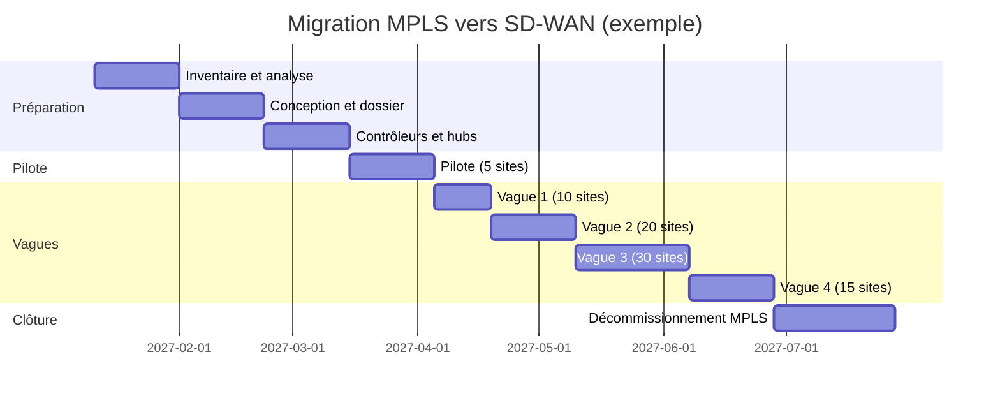

# SW14. Migration depuis MPLS et coexistence

| | |
|---|---|
| **Partie** | D. Conception, migration et exploitation |
| **Durée indicative** | 1,5 semaine (12 h) |
| **Prérequis** | SW01, SW06, SW07, SW13 ; BGP (filtrage, communautés), OSPF |
| **Niveau** | Avancé |
| **Lien examen** | ENSDWI (intégration au routage), ENARSI (BGP) |
| **Lab associé** | T12 (simulation de coexistence MPLS et SD-WAN avec BGP, balises anti-boucle, bascule) |

> Module précédent : [SW13](../SW13-conception-architecture/SW13-conception-architecture.md) | Module suivant : [SW15](../SW15-automatisation-api/SW15-automatisation-api.md)

> **Avertissement.** Les configurations sont indicatives (IOS XE) ; adaptez-les à votre version et testez-les en laboratoire avant toute production. Le périmètre, le calendrier et les contrats d'un projet réel varient fortement.

---

## Table des matières

1. [Objectifs pédagogiques](#1-objectifs-pédagogiques)
2. [Les stratégies de migration](#2-les-stratégies-de-migration)
3. [Phase 1 : inventaire et analyse](#3-phase-1--inventaire-et-analyse)
4. [Phase 2 : architecture de coexistence](#4-phase-2--architecture-de-coexistence)
5. [Routage de coexistence : BGP, balises et boucles](#5-routage-de-coexistence--bgp-balises-et-boucles)
6. [Phase 3 : pilote](#6-phase-3--pilote)
7. [Phase 4 : déploiement par vagues](#7-phase-4--déploiement-par-vagues)
8. [Bascule, retour arrière et gestion de crise](#8-bascule-retour-arrière-et-gestion-de-crise)
9. [Phase 5 : décommissionnement et contrats](#9-phase-5--décommissionnement-et-contrats)
10. [Gestion du changement et communication](#10-gestion-du-changement-et-communication)
11. [Planification, budget et indicateurs](#11-planification-budget-et-indicateurs)
12. [Lab guidé T12](#12-lab-guidé-t12)
13. [Approfondissements](#13-approfondissements)
14. [Quiz](#14-quiz)
15. [Aide-mémoire](#15-aide-mémoire)
16. [Pour aller plus loin](#16-pour-aller-plus-loin)

---

## 1. Objectifs pédagogiques

- Choisir une stratégie de migration (big bang, par vagues, par application, hybride).
- Réaliser un inventaire exhaustif de l'existant et en tirer des risques.
- Concevoir une coexistence MPLS et SD-WAN sans boucle de routage.
- Planifier un pilote, des vagues, des bascules et des retours arrière.
- Conduire la communication, la formation et le décommissionnement.
- Suivre le projet avec des indicateurs et gérer les imprévus.

---

## 2. Les stratégies de migration

| Stratégie | Principe | Avantages | Inconvénients | Quand |
|---|---|---|---|---|
| **Big bang** | Tous les sites en une seule fenêtre | Court, pas de coexistence | Risque énorme, ressources massives | Presque jamais |
| **Par vagues de sites** | Lots de sites successifs | Risque maîtrisé, apprentissage | Coexistence longue | Cas général |
| **Par application** | On déplace les flux application par application | Réduction progressive du risque | Complexité de routage | Applications critiques à protéger |
| **Par région** | Une région complète à la fois | Cohérence régionale | Dépendances inter-régions | Grandes entreprises |
| **Superposition (overlay d'abord)** | SD-WAN par-dessus MPLS (transport `mpls`), puis ajout d'Internet | Faible risque, gain progressif | MPLS reste payé longtemps | Prudence maximale |
| **Hybride durable** | MPLS conservé pour sites critiques | Compromis coût/qualité | Deux mondes à exploiter | Fréquent |

> **Recommandation d'expert** : **superposition + vagues**. On installe d'abord le SD-WAN avec MPLS comme transport (aucun changement de comportement), puis on ajoute Internet, puis on réduit MPLS site par site, avec une preuve de qualité avant chaque réduction.

---

## 3. Phase 1 : inventaire et analyse

### 3.1 Que faut-il inventorier

| Domaine | Éléments | Source |
|---|---|---|
| **Sites** | Adresse, type, utilisateurs, criticité, horaires, interlocuteur | Base d'actifs, RH, métier |
| **Liens** | Opérateur, type, débit, contrat, échéance, GTR, coût | Contrats, factures |
| **Équipements** | Routeurs, pare-feu, commutateurs, versions, fin de vie | CMDB, configurations |
| **Routage** | Protocoles, annonces, routes statiques, politiques BGP, communautés | Configurations, `show ip route` |
| **Applications et flux** | Matrice de flux, ports, dépendances, applications anciennes | NetFlow, pare-feu, entretiens |
| **Services annexes** | DNS, DHCP, NTP, proxy, VoIP, alarmes, monétique, ascenseurs, domotique | Tournées de site |
| **Sécurité** | Règles de pare-feu, accès tiers, VPN de prestataires | Configurations |
| **Contrats** | Dates de fin, préavis, pénalités | Juridique, achats |

### 3.2 Extraction automatisée des configurations

Script Python (Netmiko) qui collecte les informations de routage de tous les routeurs de l'ancien WAN :

```python
#!/usr/bin/env python3
"""Collecte d'inventaire de routage sur d'anciens routeurs CE.

Prérequis : pip install netmiko pyyaml. Identifiants par variables d'environnement.
"""
import os
import sys
from pathlib import Path
import yaml
from netmiko import ConnectHandler

COMMANDES = [
    "show version | include uptime|Version",
    "show ip bgp summary",
    "show ip route summary",
    "show ip route static",
    "show ip ospf neighbor",
    "show ip interface brief",
    "show running-config | section router bgp|router ospf|ip route|route-map|prefix-list|access-list",
]

def collecter(eq, dossier: Path):
    connexion = {"device_type": eq.get("type", "cisco_ios"), "host": eq["host"],
                 "username": os.environ["WAN_USER"], "password": os.environ["WAN_PASS"], "timeout": 60}
    try:
        with ConnectHandler(**connexion) as c:
            sortie = []
            for cmd in COMMANDES:
                sortie.append(f"\n##### {cmd}\n" + c.send_command(cmd))
            (dossier / f"{eq['name']}.txt").write_text("\n".join(sortie), encoding="utf-8")
            print("ok  ", eq["name"])
    except Exception as e:  # noqa: BLE001
        print("ERREUR", eq["name"], type(e).__name__, e)

if __name__ == "__main__":
    inv = yaml.safe_load(open(sys.argv[1]))
    sortie = Path("inventaire-routage"); sortie.mkdir(exist_ok=True)
    for eq in inv:
        collecter(eq, sortie)
```

### 3.3 Découverte des flux

Collectez **au moins 30 jours** de NetFlow/IPFIX (un cycle comptable complet, avec fin de mois) pour repérer : applications saisonnières, flux nocturnes, sauvegardes, flux inter-sites inattendus.

Extrait d'analyse (pandas) des principaux flux d'un export CSV :

```python
import pandas as pd
df = pd.read_csv("netflow.csv")          # colonnes : src, dst, dport, proto, octets
top = (df.groupby(["dst", "dport", "proto"])["octets"].sum()
         .sort_values(ascending=False).head(30))
print((top / 1e9).round(2).rename("Go"))
rares = df.groupby(["dst", "dport"])["octets"].sum().loc[lambda s: s < 1e6]
print("Flux rares mais présents :", len(rares), "(à investiguer : applications oubliées)")
```

### 3.4 Les dépendances cachées (liste issue de projets typiques)

| Dépendance | Pourquoi elle surprend |
|---|---|
| Alarme incendie ou intrusion en IP | Sur une adresse fixe et un lien dédié |
| Terminaux de paiement | Listes blanches d'adresses chez la banque |
| Imprimantes réseau centralisées | Dans un VLAN spécifique |
| Téléphonie (SIP, passerelles RTC) | Dépend d'adresses et de QoS |
| Supervision (SNMP, NetFlow) | Pointe vers des collecteurs situés ailleurs |
| Serveurs de licences, DHCP relais | Chemins statiques |
| Contrôle d'accès physique, vidéosurveillance | Flux continus vers des enregistreurs |
| Accès de tiers (prestataires) | VPN dédiés |

> Le jour de la bascule, **ce que l'on n'a pas inventorié casse**. Une tournée physique d'un échantillon de sites est irremplaçable.

---

## 4. Phase 2 : architecture de coexistence

### 4.1 Principe : trois états

```text
ÉTAT 0 (initial)  : sites <--MPLS--> sites, siège
ÉTAT 1 (coexistence) : certains sites en SD-WAN (MPLS + Internet), d'autres encore en MPLS pur ;
                       les deux mondes s'échangent des routes au niveau d'un ou deux points d'interconnexion (hubs)
ÉTAT 2 (cible)      : tous en SD-WAN ; MPLS réduit ou supprimé
```

### 4.2 Le schéma de coexistence typique

```text
 Sites hérités (MPLS pur)                         Sites migrés (SD-WAN)
   CE --- MPLS ---+                               +--- overlay : transports MPLS + Internet ---+
                  |                               |                                            |
              [ Réseau MPLS opérateur ] -- PE -- WAN Edge HUB (colonne vertébrale) -- Internet  WAN Edge agence
                  |                               |
              Siège / DC ---- LAN ----------------+
```

Le **hub SD-WAN** (au DC ou au siège) est le **point de rencontre** : il apprend les routes MPLS (BGP du CE) et les annonce dans OMP, et inversement.

### 4.3 Rôle de MPLS dans la cible

| Option | Description |
|---|---|
| **MPLS comme transport de l'overlay** | Couleur `mpls` ; tunnels IPsec par-dessus |
| **MPLS réduit** | Conservé sur hubs et sites critiques, Internet ailleurs |
| **MPLS supprimé** | Résiliation du contrat à l'échéance |

### 4.4 Chemin des flux pendant la coexistence

| Source → destination | Chemin |
|---|---|
| Site hérité → site hérité | MPLS direct (inchangé) |
| Site migré → site migré | Overlay SD-WAN |
| Site migré → site hérité | Overlay → hub → MPLS → site hérité (**via le hub**) |
| Site hérité → DC | MPLS (inchangé) |
| Site migré → DC | Overlay, ou par le hub si le DC est en MPLS |

> Le trafic entre sites migrés et hérités **passe par le hub** : prévoyez sa **capacité** et sa **latence** (détour).

---

## 5. Routage de coexistence : BGP, balises et boucles

### 5.1 Objectif

Échanger les routes **sans boucle** et sans chemins asymétriques entre le monde MPLS (eBGP avec l'opérateur) et le monde SD-WAN (OMP).

### 5.2 Configuration du hub (IOS XE, indicative)

```text
! 1) BGP avec le PE de l'opérateur, dans la VRF 10 du hub SD-WAN
router bgp 65001
 address-family ipv4 vrf 10
  neighbor 192.0.2.1 remote-as 64512
  neighbor 192.0.2.1 activate
  neighbor 192.0.2.1 route-map MPLS-IN in
  neighbor 192.0.2.1 route-map MPLS-OUT out
  redistribute omp route-map OMP-TO-BGP
 exit-address-family
!
! 2) Marquer les routes issues d'OMP quand elles partent vers MPLS
ip community-list standard FROM-SDWAN permit 65001:777
route-map OMP-TO-BGP permit 10
 set community 65001:777 additive
!
! 3) Refuser dans OMP ce qui est marqué SD-WAN (déjà passé par OMP) : politique appliquée à l'injection BGP -> OMP
route-map BGP-TO-OMP deny 10
 match community FROM-SDWAN
route-map BGP-TO-OMP permit 20
!
! 4) Filtres vers/depuis l'opérateur
ip prefix-list SDWAN-AGENCES seq 10 permit 10.12.0.0/14 le 24
ip prefix-list LEGACY-SITES seq 10 permit 10.20.0.0/14 le 24
route-map MPLS-OUT permit 10
 match ip address prefix-list SDWAN-AGENCES
route-map MPLS-IN permit 10
 match ip address prefix-list LEGACY-SITES
!
sdwan
 omp
  address-family ipv4 vrf 10
   advertise bgp route-policy BGP-TO-OMP
```

> Le point d'application exact de la politique de filtrage BGP → OMP (modèle, route-policy dans le modèle OMP, ou route-map) dépend de la version. Le **principe** à retenir : **marquer en sortie, filtrer en entrée**.

### 5.3 Pourquoi les boucles apparaissent

Si **deux hubs** apprennent à la fois les routes SD-WAN (par OMP) et les routes MPLS (par BGP), et se les redistribuent mutuellement, un préfixe d'un site migré peut revenir depuis MPLS vers l'overlay avec un meilleur attribut et créer une boucle.

```text
Site migré 10.12.5.0/24 -- OMP --> Hub A -- eBGP/MPLS --> Hub B -- OMP --> Site migré : ROUTE "REVENUE"
Parade : communauté 65001:777 posée par Hub A ; Hub B refuse toute route BGP portant 65001:777 avant injection dans OMP
```

### 5.4 Préférences et chemins

| Objectif | Mécanisme |
|---|---|
| Préférer le chemin SD-WAN pour un site migré | Local preference plus haute côté hub ; préférence de route OMP |
| Éviter le trafic asymétrique | Annoncer des routes **identiques** sur les deux hubs ; AS-path prepend maîtrisé |
| Garder MPLS en secours d'un site migré | Couleur `mpls` conservée ; priorité plus basse |
| Résumer | Résumés par région pour limiter la table |

### 5.5 Vérifications

```text
show ip bgp vrf 10 summary
show ip bgp vrf 10 community 65001:777
show ip route vrf 10 10.12.5.0
show sdwan omp routes vpn 10 10.12.5.0/24 detail
show sdwan policy service-path vpn 10 interface GigabitEthernet3 source-ip 10.12.5.10 dest-ip 10.20.1.5 protocol 1 all
traceroute vrf 10 10.20.1.5 source GigabitEthernet3
```

---

## 6. Phase 3 : pilote

### 6.1 Choix des sites pilotes

| Critère | Choix |
|---|---|
| Nombre | 3 à 5 sites |
| Diversité | Un petit, un moyen, un site avec 4G, un avec particularité (NAT, OT) |
| Risque | Pas de site critique en premier ; un site « amical » (équipe locale coopérative) |
| Durée | 2 à 4 semaines d'observation |

### 6.2 Critères de sortie du pilote

| Critère | Seuil |
|---|---|
| Disponibilité | ≥ 99,9 % sur la période |
| Qualité voix et applications | Pas de dégradation vs avant (MOS, délais) |
| Incidents bloquants | 0 |
| Procédures | Runbooks testés |
| Satisfaction des utilisateurs | Enquête ≥ seuil |
| Équipe | Exploitation capable de dépanner sans l'intégrateur |

### 6.3 Plan de tests de recette d'un site (extrait)

| # | Test | Attendu |
|---|---|---|
| 1 | Connexions de contrôle | up (`show sdwan control connections`) |
| 2 | Tunnels BFD | Toutes les sessions attendues up |
| 3 | Accès aux applications critiques | Réponse < seuil |
| 4 | Bascule d'un transport (débrancher) | Reprise < 10 s ; appels voix maintenus ou rétablis |
| 5 | Voix | MOS ≥ 4,0 sur appel de test |
| 6 | Sortie Internet locale | Filtrage actif |
| 7 | Segmentation | Invités ne voient pas CORP |
| 8 | MTU | Gros transferts sans blocage |
| 9 | Supervision | Alarmes et graphiques visibles |
| 10 | Retour arrière | Procédure testée |

---

## 7. Phase 4 : déploiement par vagues

### 7.1 Industrialisation

| Élément | Contenu |
|---|---|
| **Équipes** | Équipe de projet, équipe de déploiement, support local, centre d'appels |
| **Logistique** | Stock tampon, étiquettes, expédition, retours |
| **Préparation du site** | Fiche « avant livraison » : alimentation, emplacement, câblage, accès Internet livré, personne présente |
| **Configuration** | Génération de variables par script (SW06), pré-enregistrement des équipements (PnP) |
| **Bascule** | Fenêtre, check-list, interlocuteur technique joignable |
| **Hypercare** | 3 à 5 jours de surveillance renforcée après la bascule |

### 7.2 Rythme

Exemple : 80 sites sur 14 semaines.

| Semaine | Sites | Cumul |
|---|---|---|
| 1 à 2 | Pilote (5) | 5 |
| 3 à 4 | Vague 1 (10) | 15 |
| 5 à 7 | Vague 2 (20) | 35 |
| 8 à 11 | Vague 3 (30) | 65 |
| 12 à 14 | Vague 4 (15) | 80 |

Règle : **ne pas augmenter la taille d'une vague tant que la précédente n'est pas stable**.

### 7.3 Diagramme de planification (Mermaid)



### 7.4 Mode opératoire de la nuit de bascule (modèle)

```text
J-7  : validation des prérequis (accès Internet livré, équipement reçu, contact local)
J-1  : préconfiguration vérifiée ; sauvegarde de la configuration de l'ancien routeur ; plan de retour arrière relu
H-0  : début de la fenêtre ; contact avec le site
H+10 : branchement de l'équipement SD-WAN ; ZTP ; contrôle des connexions de contrôle
H+25 : tests de recette (section 6.3)
H+40 : bascule des routes (annonce du site côté hub, retrait côté MPLS) ; tests applicatifs avec l'utilisateur local
H+60 : décision GO / NO-GO ; en cas de NO-GO, retour arrière (restauration des annonces MPLS)
H+90 : fin de fenêtre ; compte rendu
J+1..J+5 : hypercare
```

---

## 8. Bascule, retour arrière et gestion de crise

### 8.1 Principe du retour arrière

Pour chaque site : **la capacité de revenir à l'ancien état en moins de 15 minutes** pendant la fenêtre, tant que l'ancien lien MPLS reste en place.

| Élément | Retour arrière |
|---|---|
| Routage | Remise des annonces MPLS (route-map, prefix-list) |
| Équipement | Maintien de l'ancien routeur sous tension et connecté pendant 2 semaines |
| Adresses | Aucune modification d'adressage LAN |
| Documentation | Procédure imprimée et testée |

### 8.2 Critères GO / NO-GO

| Critère | GO si |
|---|---|
| Tunnels | Tous les transports prévus sont up |
| Applications critiques | Testées par un utilisateur du site |
| Voix | Appel de test réussi |
| Supervision | Équipement visible et sans alarme critique |
| Temps restant | Au moins 30 min de marge avant la fin de fenêtre |

### 8.3 Gestion de crise

1. **Un seul responsable** de la décision pendant la fenêtre.
2. **Canal de communication unique** (audioconférence ou salon dédié).
3. **Journal horodaté** tenu en direct.
4. **Seuils d'escalade** : 30 minutes sans résolution → direction de projet ; 60 minutes → retour arrière.
5. **Communication aux utilisateurs** : message simple, heure de retour.

---

## 9. Phase 5 : décommissionnement et contrats

### 9.1 Étapes

| Étape | Détail |
|---|---|
| **Validation** | Le site est stable depuis au moins 30 jours, plus de trafic MPLS (contrôle des compteurs) |
| **Dépose** | Retrait des équipements hérités, effacement sécurisé des configurations et disques |
| **Résiliation** | Lettre de résiliation de chaque lien respectant le **préavis** contractuel |
| **Mise à jour** | CMDB, schémas, supervision, sauvegardes |
| **Retour d'expérience** | Revue de la vague |

### 9.2 Pièges contractuels

| Piège | Parade |
|---|---|
| Résiliation tardive : reconduction tacite | Calendrier des préavis, relances à J-120/J-90 |
| Pénalités de sortie anticipée | Négocier un **avenant de réduction progressive** |
| Dépendance d'un site à un lien unique MPLS | Traiter avant résiliation |
| Équipements loués par l'opérateur | Récupération et logistique de retour |
| Perte d'adresses fournies par l'opérateur (adresses PA) | Planifier le changement d'adressage ou l'acquisition d'adresses PI |

### 9.3 Calcul d'économie réaliste

```text
Économie nette annuelle = coût MPLS supprimé − coût liens Internet ajoutés − licences SD-WAN − coût d'exploitation additionnel
Retour sur investissement = coût du projet / économie nette annuelle
```

Exemple : MPLS supprimé 360 k€/an ; liens Internet 120 k€/an ; licences 90 k€/an ; exploitation + 20 k€/an ; projet 250 k€.
`360 − 120 − 90 − 20 = 130 k€/an` → retour sur investissement : `250 / 130 ≈ 1,9 an`.

---

## 10. Gestion du changement et communication

| Public | Message | Moment |
|---|---|---|
| **Direction** | Bénéfices, risques, jalons | Mensuel |
| **Directeurs de sites** | Ce qui change, calendrier, prérequis, interlocuteur | 6 semaines, 2 semaines, 3 jours avant |
| **Utilisateurs** | Date, interruption possible, qui appeler | 1 semaine avant et la veille |
| **Support (helpdesk)** | Procédures, FAQ, outils | Avant la première vague |
| **Exploitation** | Formation, runbooks, supervision | Avant le pilote |
| **Prestataires et tiers** | Changements d'adresses, accès | Dès l'inventaire |

Formation : un parcours **exploitation** (3 à 5 jours avec lab), un parcours **helpdesk** (1 jour), une fiche **d'urgence** pour les sites.

---

## 11. Planification, budget et indicateurs

### 11.1 Indicateurs de projet

| Indicateur | Cible |
|---|---|
| Sites migrés / planifiés | Selon le calendrier |
| Taux de bascules réussies du premier coup | ≥ 95 % |
| Incidents P1/P2 post-bascule | ≤ 1 par vague |
| Délai moyen de bascule (fenêtre utilisée) | < 4 h |
| Satisfaction utilisateur | Hausse vs avant |
| Économies réalisées vs plan | ≥ 90 % du plan |
| Retours arrière | < 5 % |

### 11.2 Budget (postes)

Équipements, licences, accès Internet, services professionnels, logistique, formation, double exploitation pendant la coexistence, frais de sortie contractuels, provision pour imprévus (**10 à 15 %**).

---

## 12. Lab guidé T12

### 12.1 Objectif

Simuler la coexistence d'un réseau MPLS hérité (routeurs FRRouting en BGP) et d'un site SD-WAN migré, tester la prévention de boucles par communautés et exécuter une bascule avec retour arrière.

### 12.2 Topologie

```text
 Site hérité A (AS 65101)    Site hérité B (AS 65102)
        |                          |
        +------- "MPLS" (FRR, AS 64512) -------+
                         |
                  HUB SD-WAN (AS 65001, VRF 10) ---- overlay ---- Agence migrée (site 100)
                         |
                     Siège (LAN)
```

Les routeurs hérités et le « MPLS » sont des conteneurs ou VM **FRRouting** (BGP).

### 12.3 Exemple de configuration FRR du cœur « MPLS » (AS 64512)

```text
frr defaults traditional
router bgp 64512
 no bgp ebgp-requires-policy
 neighbor 192.0.2.2 remote-as 65001      ! hub SD-WAN
 neighbor 192.0.2.10 remote-as 65101     ! site hérité A
 neighbor 192.0.2.14 remote-as 65102     ! site hérité B
 address-family ipv4 unicast
  neighbor 192.0.2.2 route-map PASS in
  neighbor 192.0.2.2 route-map PASS out
 exit-address-family
!
route-map PASS permit 10
```

Site hérité A (AS 65101) :

```text
router bgp 65101
 neighbor 192.0.2.9 remote-as 64512
 address-family ipv4 unicast
  network 10.20.1.0/24
 exit-address-family
```

### 12.4 Étapes

| # | Action | Vérification |
|---|---|---|
| 1 | Établir BGP entre les sites hérités, le « MPLS » et le hub | `show bgp summary` (FRR) |
| 2 | Annoncer 10.20.1.0/24 (A) et 10.20.2.0/24 (B) ; le hub apprend en VRF 10 | `show ip bgp vrf 10` |
| 3 | Injecter les routes BGP dans OMP (`advertise bgp`) ; l'agence migrée les reçoit | `show sdwan omp routes vpn 10` |
| 4 | Annoncer le LAN de l'agence (10.12.5.0/24) vers MPLS via `redistribute omp` avec la communauté 65001:777 | `show bgp 10.12.5.0/24` côté site hérité A |
| 5 | Tester les flux : agence migrée ↔ A ; A ↔ B | `ping`, `traceroute` |
| 6 | Introduire volontairement une **boucle** (supprimer le filtre de communauté), observer les symptômes (routes flottantes, TTL) | Captures, `show ip route` |
| 7 | Remettre le filtre, vérifier la stabilité | Routes stables 10 min |
| 8 | Simuler une bascule : retirer les annonces MPLS de l'agence ; vérifier que le trafic passe en overlay | `traceroute` |
| 9 | Simuler un **retour arrière** : remettre les annonces | Vérifier le retour |
| 10 | Rédiger le mode opératoire et le plan de retour arrière | Document |

### 12.5 Livrables et grille

| Élément | Points |
|---|---|
| Coexistence fonctionnelle (A ↔ agence migrée) | 5 |
| Démonstration de la boucle et de sa correction | 5 |
| Bascule et retour arrière chronométrés | 4 |
| Mode opératoire | 3 |
| Analyse des risques | 3 |

---

## 13. Approfondissements

### A. Glossaire du module

| Terme | Définition |
|---|---|
| **Coexistence** | Période pendant laquelle ancien et nouveau WAN fonctionnent ensemble |
| **Big bang / vagues** | Migration en une fois / par lots |
| **Pilote** | Migration d'un échantillon pour valider |
| **Hypercare** | Surveillance renforcée après une bascule |
| **GO / NO-GO** | Décision de poursuivre ou d'arrêter pendant une fenêtre |
| **Retour arrière (rollback)** | Retour à l'état antérieur |
| **Fenêtre de maintenance** | Période autorisée pour les changements |
| **CE / PE** | Routeur client / routeur de bordure de l'opérateur |
| **PA / PI** | Adresses fournies par l'opérateur / indépendantes |
| **Communauté BGP** | Étiquette attachée à une route |
| **Préavis** | Délai contractuel avant résiliation |
| **Reconduction tacite** | Renouvellement automatique du contrat |
| **CMDB** | Base de données des actifs et de leurs relations |
| **Double run** | Exploitation simultanée de deux systèmes |

### B. Cas d'usage détaillés

#### Cas 1. Migration de 80 agences d'une banque régionale

Stratégie : superposition (MPLS conservé comme transport), puis ajout d'Internet, puis réduction du débit MPLS de 10 à 2 Mbit/s par agence. Résultat : économie de 38 % sans interruption de service. Incident : une agence a perdu l'accès à un terminal de change qui dépendait d'une adresse fixe de l'ancien routeur. **Leçon** : conserver la **continuité d'adresses** et l'inventaire des appareils en IP fixe.

#### Cas 2. La boucle de routage du samedi soir

Deux hubs redistribuaient mutuellement BGP et OMP sans balise. Un préfixe d'agence s'est mis à osciller, provoquant des pertes pendant 25 minutes. Correction par communauté, tests de non-régression. **Leçon** : **testez la redistribution en laboratoire** avec des préfixes réels avant la production.

#### Cas 3. Résiliation en retard

Le préavis de 6 mois d'un contrat MPLS n'a pas été respecté : reconduction d'un an (coût : 220 k€). **Leçon** : un **calendrier des préavis** tenu par les achats et relu mensuellement est un livrable du projet.

#### Cas 4. L'agence « oubliée » avec l'alarme

Après la bascule, l'alarme intrusion d'un magasin ne remontait plus : elle utilisait le lien MPLS dédié, dans une VRF spécifique. **Parade** : tournée physique d'un échantillon de sites, **liste des équipements IP non standards** avant bascule.

#### Cas 5. Un hub saturé par le trafic de coexistence

Pendant 6 mois de coexistence, le trafic entre sites migrés et hérités passe par le hub et sature son lien de 1 Gbit/s. Solution : montée du hub à 2 × 1 Gbit/s, et accélération de la migration des sites les plus échangeurs. **Leçon** : **mesurez la matrice de trafic** hérité/migré pour dimensionner le hub.

#### Cas 6. Retour arrière réussi

Pendant une bascule, la voix présente 3 % de perte sur le lien Internet d'un site. Le critère de NO-GO est atteint ; en 12 minutes, le site revient en MPLS. Le problème (box opérateur en mauvais mode) est corrigé, la bascule refaite la semaine suivante. **Leçon** : **un retour arrière rapide est une réussite**, pas un échec.

### C. Retours d'expérience

1. **L'inventaire décide de la réussite.** Passez-y 20 à 30 % du temps de préparation.
2. **Gardez l'ancien lien vivant** au moins deux semaines après la bascule.
3. **Un site « facile » mal préparé coûte plus qu'un site complexe bien préparé.**
4. **Les bascules se font avec les gens du site**, pas à distance seulement : quelqu'un doit tester physiquement.
5. **Chaque vague apprend à la suivante** : retour d'expérience obligatoire, mise à jour des runbooks.
6. **Ne négociez jamais la résiliation avant d'avoir stabilisé.** Mais respectez le préavis.
7. **Évitez les vendredis et les périodes de pointe métier** (soldes, fin de mois, inventaires).
8. **Communiquez trop plutôt que pas assez.** Un utilisateur prévenu supporte une coupure ; un utilisateur surpris appelle le directeur.

### D. Exercices supplémentaires

1. Rédigez la **fiche « avant livraison »** d'un site (10 questions que le responsable de site doit valider).
2. Calculez le retour sur investissement : MPLS supprimé 480 k€/an, Internet ajouté 150 k€/an, licences 110 k€/an, exploitation + 30 k€/an, projet 320 k€.
3. Écrivez la route-map et la prefix-list d'un hub qui ne doit annoncer vers l'opérateur que les préfixes des agences migrées.
4. Listez 10 équipements « cachés » à rechercher lors d'un inventaire de magasins, et comment les détecter.

<details>
<summary>Corrigés</summary>

2. `480 − 150 − 110 − 30 = 190 k€/an` ; retour sur investissement `320 / 190 ≈ 1,7 an`.
3. `ip prefix-list MIGRES seq 10 permit 10.12.0.0/14 le 24` ; `route-map MPLS-OUT permit 10` + `match ip address prefix-list MIGRES` ; aucun autre `permit` (refus implicite).
4. Alarme, monétique, imprimantes, caméras/enregistreurs, téléphonie, contrôle d'accès, balances/étiquettes, bornes, affichage dynamique, domotique. Détection : tournée physique, tables ARP/MAC, NetFlow, scan d'inventaire (nmap), baux DHCP.

</details>

### E. Mini-projet (10 heures)

Rédigez le **plan de migration complet** d'une entreprise fictive de 60 sites : inventaire (modèle), stratégie argumentée, architecture de coexistence, plan de routage, plan de tests, planning par vagues (Gantt), mode opératoire de nuit de bascule, plan de retour arrière, communication, budget et indicateurs, calendrier des préavis. Soutenez-le devant un comité de pilotage fictif.

---

## 14. Quiz

1. Quelle stratégie de migration est la plus prudente ?
2. Que fait-on à la porte de coexistence pour éviter les boucles ?
3. Pourquoi le trafic entre site migré et site hérité passe-t-il par le hub ?
4. Que signifie GO / NO-GO ?
5. Pourquoi conserver l'ancien lien après la bascule ?
6. Quel est le piège contractuel le plus fréquent ?

<details>
<summary>Réponses</summary>

1. La superposition (SD-WAN sur MPLS) avec déploiement par vagues. 2. Marquer en sortie (communauté) et filtrer en entrée. 3. Parce que le hub est le seul point qui connaît les deux mondes de routage. 4. Décision de continuer ou d'arrêter selon des critères prédéfinis. 5. Pour permettre un retour arrière et détecter les dépendances cachées. 6. La reconduction tacite faute de respect du préavis.

</details>

---

## 15. Aide-mémoire

```text
Stratégie : superposition + vagues ; pilote 3-5 sites ; vague suivante seulement si la précédente est stable
Inventaire : sites, liens, routage, flux (30 j NetFlow), IP fixes cachées, contrats/préavis
Coexistence : hub = point de rencontre ; marquer (communauté) en sortie, filtrer en entrée ; résumer
Bascule : GO/NO-GO, retour arrière < 15 min, ancien lien conservé 2 semaines, hypercare 3-5 jours
Fin : décommissionnement, résiliation dans les préavis, CMDB à jour
ROI = coût projet / (MPLS supprimé − Internet − licences − exploitation)
```

## 16. Pour aller plus loin

- RFC 4271 (BGP-4) et RFC 1997 (communautés BGP) : <https://www.rfc-editor.org/rfc/rfc4271>
- Cisco, guides de migration et de coexistence MPLS/SD-WAN : <https://www.cisco.com/c/en/us/solutions/enterprise-networks/sd-wan/index.html>
- FRRouting : <https://frrouting.org>

> Module précédent : [SW13](../SW13-conception-architecture/SW13-conception-architecture.md) | Module suivant : [SW15](../SW15-automatisation-api/SW15-automatisation-api.md)
